# One review policy, and plain wording across the review skills

<!-- AT-A-GLANCE:BEGIN (generated — do not edit; refreshed by render_plan.py --summarize) -->
## At a glance

**9 tasks · 4 waves · 24 files · 9/9 done**

| Wave | Task | Title | Files | Done (acceptance) |
|---|---|---|---|---|
| 1 | 1.1 | Policy file and rule inventory (wave 1) | rules/review-policy.md, tests/scripts/rule-loading-tiers.test.sh, CLAUDE.md | SC-1, SC-2, SC-17 and SC-18 exit 0. |
| 2 | 2.1 | Reviewer agents in plain wording (wave 2) | agents/reviewer.md, agents/task-reviewer.md | SC-14, SC-15 and SC-17 exit 0; the two files hold no more words than at 33d6ed4. |
| 2 | 2.2 | Correctness and intent SKILL files in plain wording (wave 2) | skills/correctness-review/SKILL.md, skills/intent-review/SKILL.md | SC-7, SC-11, SC-16 and SC-17 exit 0; the two files hold no more words than at 33… |
| 2 | 2.3 | Audit skill and review chain reference in plain wording (wave 2) | skills/context-propagation-audit/SKILL.md, skills/subagent-driven-development/references/review-chain.md | SC-11, SC-16 and SC-18 exit 0; the two files hold no more words than at 33d6ed4. |
| 3 | 3.1 | Correctness finder prompts with the policy Read (wave 3) | skills/correctness-review/prompts/shared.md, skills/correctness-review/prompts/angles/call-site-impact.md, skills/correctness-review/prompts/angles/enclosing-function.md, skills/correctness-review/prompts/angles/guard-completeness.md, skills/correctness-review/prompts/angles/prior-art.md, skills/correctness-review/prompts/angles/removed-behavior.md, skills/correctness-review/prompts/angles/stack-defects.md, skills/correctness-review/correctness-reviewer-prompt.md | SC-9, SC-10, SC-8 and SC-17 exit 0; `prompts/shared.md` has a line containing ``… |
| 3 | 3.2 | Correctness scorer prompt in plain wording (wave 3) | skills/correctness-review/correctness-scorer-prompt.md | SC-8, SC-9, SC-12 and SC-18 exit 0; the file holds no more words than at 33d6ed4… |
| 3 | 3.3 | Intent reviewer prompt with the policy Read (wave 3) | skills/intent-review/intent-reviewer-prompt.md | SC-7, SC-11, SC-12 and SC-17 exit 0; the file has a line containing ``**Read `ru… |
| 3 | 3.4 | Task reviewer prompt, label field and contract (wave 3) | skills/subagent-driven-development/task-reviewer-prompt.md, scripts/check_task_review_contract.py, scripts/test_check_task_review_contract.py | SC-5, SC-13 and SC-12 exit 0; the prompt has a line containing ``**Read `rules/r… |
| 4 | 4.1 | Register the policy Reads in the context matrix (wave 4) | scripts/render_skill_prompt.py, scripts/test_render_skill_prompt.py | SC-3, SC-4 and SC-6 exit 0; SC-19 exits 0 once the controller has recorded the w… |

```mermaid
flowchart LR
  subgraph W0[Wave 1]
    T1_1["1.1 Policy file and rule inventory (wave 1)"]
  end
  subgraph W1[Wave 2]
    T2_1["2.1 Reviewer agents in plain wording (wave 2)"]
    T2_2["2.2 Correctness and intent SKILL files in plain wording (wave 2)"]
    T2_3["2.3 Audit skill and review chain reference in plain wording (wave 2)"]
  end
  subgraph W2[Wave 3]
    T3_1["3.1 Correctness finder prompts with the policy Read (wave 3)"]
    T3_2["3.2 Correctness scorer prompt in plain wording (wave 3)"]
    T3_3["3.3 Intent reviewer prompt with the policy Read (wave 3)"]
    T3_4["3.4 Task reviewer prompt, label field and contract (wave 3)"]
  end
  subgraph W3[Wave 4]
    T4_1["4.1 Register the policy Reads in the context matrix (wave 4)"]
  end
  W0 --> W1
  W1 --> W2
  W2 --> W3
```



### Progress
- [x] 1.1 — Policy file and rule inventory (wave 1)
- [x] 2.1 — Reviewer agents in plain wording (wave 2)
- [x] 2.2 — Correctness and intent SKILL files in plain wording (wave 2)
- [x] 2.3 — Audit skill and review chain reference in plain wording (wave 2)
- [x] 3.1 — Correctness finder prompts with the policy Read (wave 3)
- [x] 3.2 — Correctness scorer prompt in plain wording (wave 3)
- [x] 3.3 — Intent reviewer prompt with the policy Read (wave 3)
- [x] 3.4 — Task reviewer prompt, label field and contract (wave 3)
- [x] 4.1 — Register the policy Reads in the context matrix (wave 4)
<!-- AT-A-GLANCE:END -->

## 1. Motivation

The review passes each carry their own severity scale and "do not report" list, and their prompts
repeat text across files. Per the approved design (`design.md`, D1–D8), add one path-scoped review
policy that the task, correctness and intent reviewers read explicitly, and rewrite every review
agent and skill in plain wording without changing behavior. Research: `research-brief.md`.

## 2. Non-goals

- No change to which findings block, the scorer threshold, any severity scale, or any oracle.
- No change to `/code-review`, `scripts/run_review_chain_eval.py`, Codex adapter scripts, or `.claude/`.
- No count cap on Nits (D4).

## 3. Success Criteria

| ID | Behavior (observable) | Check (re-runnable) | Expected |
|---|---|---|---|
| SC-1 | The policy file exists with `paths:` scoped to `specs/*/SUMMARY.md` and its four sections | `python3 -c "import sys;t=open('rules/review-policy.md').read();sys.exit(not(t.startswith('---') and 'specs/*/SUMMARY.md' in t.split('---')[1] and all(h in t for h in ('## Important or Nit','## Nit reporting','## Do not report','## Finding labels'))))"` | exit 0 |
| SC-2 | The rule inventory names the new path-scoped rule in the test and in `CLAUDE.md` | `bash tests/scripts/rule-loading-tiers.test.sh` | exit 0 |
| SC-3 | The task reviewer, the correctness finders and the intent reviewer each require an explicit Read of the policy | `python3 -m pytest -q scripts/test_render_skill_prompt.py` | exit 0 |
| SC-4 | Child-context delivery, including the policy Reads, passes the context-propagation regression | `bash tests/scripts/context-propagation-regression.test.sh` | exit 0 |
| SC-5 | The task-reviewer output schema has the `checked_against` label and the contract checker requires it | `python3 -m pytest -q scripts/test_check_task_review_contract.py` | exit 0 |
| SC-6 | The 17 in-scope review files total at most 7,867 words (budget) | `python3 -c "import glob,sys;fs=['agents/reviewer.md','agents/task-reviewer.md','skills/correctness-review/SKILL.md','skills/correctness-review/correctness-reviewer-prompt.md','skills/correctness-review/correctness-scorer-prompt.md','skills/correctness-review/prompts/shared.md','skills/intent-review/SKILL.md','skills/intent-review/intent-reviewer-prompt.md','skills/subagent-driven-development/task-reviewer-prompt.md','skills/subagent-driven-development/references/review-chain.md','skills/context-propagation-audit/SKILL.md']+sorted(glob.glob('skills/correctness-review/prompts/angles/*.md'));n=sum(len(open(f).read().split()) for f in fs);print(n);sys.exit(n>7867)"` | exit 0 |
| SC-7 | Intent-review pinned contract strings survive the rewrite | `bash tests/scripts/intent-prompt-contract.test.sh` | exit 0 |
| SC-8 | The scorer threshold contract still holds | `bash tests/scripts/scorer-threshold-contract.test.sh` | exit 0 |
| SC-9 | Correctness prompts still compose with all six angles | `bash tests/scripts/correctness-prompt-composition.test.sh` | exit 0 |
| SC-10 | The inline Rule-4 list in the finder prompt still matches `rules/auto-correct-scope.md` | `bash tests/scripts/inline-policy-drift.test.sh` | exit 0 |
| SC-11 | The review-package contract still holds for both review skills and the review chain | `bash tests/scripts/final-review-package-contract.test.sh` | exit 0 |
| SC-12 | Runtime model-stage bindings still resolve from the review prompts | `bash tests/scripts/runtime-entry-bindings.test.sh` | exit 0 |
| SC-13 | SDD artifact handoffs (including `Fix round`) still hold | `bash tests/scripts/sdd-artifact-handoffs.test.sh` | exit 0 |
| SC-14 | The reviewer agents still render unchanged bodies with their required phrases | `python3 -m pytest -q scripts/test_render_agent_definitions.py` | exit 0 |
| SC-15 | The task-reviewer agent stays read-only | `bash tests/scripts/task-reviewer-readonly.test.sh` | exit 0 |
| SC-16 | Skill word ceilings and prompt inventory still pass | `python3 -m pytest -q scripts/test_audit_skill_prompts.py` | exit 0 |
| SC-17 | No runtime-coupled text was introduced into agents, rules, or skills | `python3 scripts/check_runtime_neutral_sources.py --root .` | exit 0 |
| SC-18 | Every path named in agents, rules and skills still exists | `bash scripts/lint-doc-truth.sh` | exit 0 |
| SC-19 | Every rewritten file has a meaning-equivalence record in SUMMARY | `python3 -c "import glob,sys;t=open('specs/review-policy/SUMMARY.md').read().split('### Meaning-equivalence review')[1].split('\n### ')[0];fs=['agents/reviewer.md','agents/task-reviewer.md','skills/correctness-review/SKILL.md','skills/correctness-review/correctness-reviewer-prompt.md','skills/correctness-review/correctness-scorer-prompt.md','skills/correctness-review/prompts/shared.md','skills/intent-review/SKILL.md','skills/intent-review/intent-reviewer-prompt.md','skills/subagent-driven-development/task-reviewer-prompt.md','skills/subagent-driven-development/references/review-chain.md','skills/context-propagation-audit/SKILL.md']+sorted(glob.glob('skills/correctness-review/prompts/angles/*.md'));m=[f for f in fs if f not in t];print(m);sys.exit(bool(m))"` | exit 0 |

## Global Constraints

- Edit the source tree only. Never edit `.claude/`, `VERSION`, or `CHANGELOG.md`.
- **Wording, not behavior** (design Architecture → Rewrite): each reviewer keeps its oracle, inputs, output schema (apart from `checked_against`), finding categories and blocking rules. Add no step and no rule outside the policy.
- **Rewrite checklist:** complete imperative sentences; one word per concept; no invented shorthand; no explanation repeated across files where the reader already receives it; no rationale the model does not need in order to act; no CAPS or MUST emphasis for a rule a gate already enforces. A child prompt is read in a fresh context, so keep any text it needs even if the controller also has it.
- **Pinned strings** (research-brief → Local Findings): keep every pinned phrase verbatim **on one physical line**, because the checks are line-based. Do not write any threshold phrasing (`threshold N`, `scoring N or`, `score >= N`, `below **N**`, `default **N**`) under `skills/` with a number other than 75. Keep no `{{`/`}}` in correctness prompts. Keep the "harness repo" marker within one line of `scripts/render_runtime_entry.py` and `scripts/harness-status.sh` mentions. Keep agent descriptions on one line, and add no `tools`/`model`/`effort`/`memory` frontmatter.
- **Runtime-neutral:** no `.claude/rules/` or `.claude/skills/` paths, no slash-skill invocations, no vendor model labels in agents, rules or skills.
- **Policy file `rules/review-policy.md`**, exact frontmatter:

  ```text
  ---
  paths:
    - "specs/*/SUMMARY.md"
  ---
  ```

  Exact section headings: `## Important or Nit`, `## Nit reporting`, `## Do not report`, `## Finding labels`. Content per design Architecture items 1–4 and D5, D7: Important/Nit table mapped onto task review (Critical, Important / Minor), correctness review (scored at or above the threshold / below it), intent review (gap and behavior-changing drift / equivalent drift; excess report-only); Nits stay in the existing findings list under the existing severity or class, never open a fix round, and are recorded in SUMMARY; no count cap; do-not-report: generated files (`PLAN.html`, `.plan-review.json`, deployed harness copies, `*.lock`), lint and format findings the project's linters or formatters already check (`agents/PROJECT.md` → Test execution), and — for correctness and intent review only — style, naming and formatting, which belong to the task reviewer's quality verdict; labels: the task reviewer sets `checked_against: SC-n | none` per finding, intent review's verbatim intent quote is its label, correctness review has none because it is plan-blind. Stack-neutral text.
- **Read line** in each of the three child prompts: one physical line (leading indentation allowed, it may sit mid-sentence) containing ``**Read `rules/review-policy.md`**`` with the path backticked, because `render_skill_prompt.py` `required_reads` matches `\bRead\b` followed by the backticked path. In `task-reviewer-prompt.md`, word it so it does not contradict the opening "Read only the supplied task brief, report, and review package paths first".
- **Word budget per task:** each rewrite task leaves its own files with no more words in total than at 33d6ed4 (count with `len(text.split())`, comparing HEAD to `git show 33d6ed4:<file>`), so SC-6 (budget 7,867, measured 2026-10-11 = the current count) holds after every wave.
- **pytest:** this machine's `python3` has no pytest. Run every `python3 -m pytest` Verify and SC with `/tmp/harness-tests-venv/bin` first on `PATH` (the venv `scripts/run-tests.sh` builds).
- **Task-reviewer schema field**, exact line inside the findings item: `checked_against: SC-n | none`.
- `skills/subagent-driven-development/SKILL.md` is at the 600-word ceiling (measured 2026-10-11): do not edit it.
- **Meaning-equivalence review** (design D6): after each of waves 2 and 3, the controller dispatches one read-only reviewer per task with the base and new text of each file it rewrote, and records each file's dropped, changed and added instructions, with the resolution, in SUMMARY under `### Meaning-equivalence review`. Write each file as its repo-relative path and use `####` headings or bullets inside the section (SC-19 stops at the next `### `). An unexplained item blocks the wave; SC-19 checks only that every file is named.
- A same-wave Verify that fails because of a sibling's file is attributed to the task that owns that file.

## 4. Tasks

### Task 1.1 — Policy file and rule inventory (wave 1)

- **Files:** rules/review-policy.md, tests/scripts/rule-loading-tiers.test.sh, CLAUDE.md
- **Action:** Update `tests/scripts/rule-loading-tiers.test.sh` first: its contextual set becomes
  ` auto-correct-scope.md plan-format.md review-policy.md terminology.md wave-parallelism.md` and its
  `CLAUDE.md` grep expects `five path-scoped ones`. Run it and see it fail. Write
  `rules/review-policy.md` per Global Constraints. Update `CLAUDE.md` line 7: "four path-scoped
  ones" becomes "five path-scoped ones" and the list names `review-policy.md`. Rename the test's
  "four contextual files" title to match.
- **Verify:** `bash tests/scripts/rule-loading-tiers.test.sh`
- **Done:** SC-1, SC-2, SC-17 and SC-18 exit 0.
- **Criteria:** SC-1, SC-2
- **Interfaces:** Consumes the design's policy content. Produces `rules/review-policy.md` and the updated `tests/scripts/rule-loading-tiers.test.sh` inventory.

### Task 2.1 — Reviewer agents in plain wording (wave 2)

- **Files:** agents/reviewer.md, agents/task-reviewer.md
- **Action:** Rewrite both agent bodies against the rewrite checklist, keeping every pinned phrase
  (`structurally read-only`, `not by instruction`, `Acknowledged limitation`, `never fix`,
  `structural, not a promise`, `cannot write, edit, spawn agents`) and the one-line descriptions.
- **Verify:** `python3 -m pytest -q scripts/test_render_agent_definitions.py`
- **Done:** SC-14, SC-15 and SC-17 exit 0; the two files hold no more words than at 33d6ed4.
- **Criteria:** SC-14, SC-15
- **Interfaces:** Consumes the current agent bodies. Produces reworded `agents/reviewer.md` and `agents/task-reviewer.md`.

### Task 2.2 — Correctness and intent SKILL files in plain wording (wave 2)

- **Files:** skills/correctness-review/SKILL.md, skills/intent-review/SKILL.md
- **Action:** Rewrite both controller skills against the rewrite checklist. Keep the pinned
  phrases (intent: `verbatim primary oracle`, `ask the user instead of reconstructing`,
  ``never `PLAN.md` prose``, `**gap:**`, `**drift:**`, `**excess:**`; both: `REVIEW_PACKAGE_PATH`,
  `rules/auto-correct-scope.md`), every inline command covered by `allowed-tools`, and the 600-word
  ceiling.
- **Verify:** `bash tests/scripts/intent-prompt-contract.test.sh`
- **Done:** SC-7, SC-11, SC-16 and SC-17 exit 0; the two files hold no more words than at 33d6ed4.
- **Criteria:** SC-7, SC-11, SC-16
- **Interfaces:** Consumes the current controller text. Produces reworded `skills/correctness-review/SKILL.md` and `skills/intent-review/SKILL.md`.

### Task 2.3 — Audit skill and review chain reference in plain wording (wave 2)

- **Files:** skills/context-propagation-audit/SKILL.md, skills/subagent-driven-development/references/review-chain.md
- **Action:** Rewrite both against the rewrite checklist. Keep `branch review package` and
  `oracle inputs and blindness rules remain unchanged` in `review-chain.md`, and add no inline
  command to the audit skill beyond its `allowed-tools` (`Read, Write, Grep, Glob`).
- **Verify:** `bash tests/scripts/final-review-package-contract.test.sh`
- **Done:** SC-11, SC-16 and SC-18 exit 0; the two files hold no more words than at 33d6ed4.
- **Criteria:** SC-11, SC-16
- **Interfaces:** Consumes the current text. Produces reworded `skills/context-propagation-audit/SKILL.md` and `skills/subagent-driven-development/references/review-chain.md`.

### Task 3.1 — Correctness finder prompts with the policy Read (wave 3)

- **Files:** skills/correctness-review/prompts/shared.md, skills/correctness-review/prompts/angles/call-site-impact.md, skills/correctness-review/prompts/angles/enclosing-function.md, skills/correctness-review/prompts/angles/guard-completeness.md, skills/correctness-review/prompts/angles/prior-art.md, skills/correctness-review/prompts/angles/removed-behavior.md, skills/correctness-review/prompts/angles/stack-defects.md, skills/correctness-review/correctness-reviewer-prompt.md
- **Action:** Rewrite against the rewrite checklist. Add the policy Read line to
  `prompts/shared.md`. Replace the style bullet in "Out of scope" (around line 69) with that Read.
  Around line 41, keep the "no trigger means no finding, do not report it" instruction and drop only
  the attribution of style to the quality reviewer. Keep the rest of the out-of-scope list. Keep the pinned `REVIEW_PACKAGE_PATH` text,
  `do not rebuild the same full diff`, the `**Read ...auto-correct-scope.md` line, the
  `Rule 4 STOP cases:` … `This list is a summary` range with its eight tokens, `scoring 75 or`,
  the six backticked angle names, and the angle filenames.
- **Verify:** `bash tests/scripts/correctness-prompt-composition.test.sh`
- **Done:** SC-9, SC-10, SC-8 and SC-17 exit 0; `prompts/shared.md` has a line containing ``**Read `rules/review-policy.md`**``; the eight files hold no more words than at 33d6ed4.
- **Criteria:** SC-8, SC-9, SC-10
- **Interfaces:** Consumes `rules/review-policy.md` (Task 1.1). Produces the reworded finder prompts and the Read line in `skills/correctness-review/prompts/shared.md`.

### Task 3.2 — Correctness scorer prompt in plain wording (wave 3)

- **Files:** skills/correctness-review/correctness-scorer-prompt.md
- **Action:** Rewrite against the rewrite checklist. Add no policy Read (design Architecture → Delivery: the scorer does
  not classify). Keep the `"score": <…>` line, the five bold anchors, `default threshold is **75**`,
  `floor is 60`, `model_stage: correctness_scorer`, and the "harness repo" marker by
  `scripts/render_runtime_entry.py` and `scripts/harness-status.sh`.
- **Verify:** `bash tests/scripts/scorer-threshold-contract.test.sh`
- **Done:** SC-8, SC-9, SC-12 and SC-18 exit 0; the file holds no more words than at 33d6ed4.
- **Criteria:** SC-8, SC-12
- **Interfaces:** Consumes the current scorer text. Produces reworded `skills/correctness-review/correctness-scorer-prompt.md`.

### Task 3.3 — Intent reviewer prompt with the policy Read (wave 3)

- **Files:** skills/intent-review/intent-reviewer-prompt.md
- **Action:** Rewrite against the rewrite checklist. Add the policy Read line and replace the
  style line in "Out of scope" (around line 119) with it. Keep the PLAN.md prohibition lines
  (`FORBIDDEN from reading … PLAN.md` on one line), `REVIEW_PACKAGE_PATH`,
  `do not rebuild the same full diff`, `model_stage: intent_reviewer`, the verbatim-quote rule,
  and the "harness repo" marker.
- **Verify:** `bash tests/scripts/intent-prompt-contract.test.sh`
- **Done:** SC-7, SC-11, SC-12 and SC-17 exit 0; the file has a line containing ``**Read `rules/review-policy.md`**`` and holds no more words than at 33d6ed4.
- **Criteria:** SC-7, SC-11, SC-12
- **Interfaces:** Consumes `rules/review-policy.md`. Produces reworded `skills/intent-review/intent-reviewer-prompt.md` with the Read line.

### Task 3.4 — Task reviewer prompt, label field and contract (wave 3)

- **Files:** skills/subagent-driven-development/task-reviewer-prompt.md, scripts/check_task_review_contract.py, scripts/test_check_task_review_contract.py
- **Action:** Add `checked_against: SC-n | none` to the checker's `REQUIRED` tuple and a test case
  that monkeypatches the checker's module-level `ROOT` to a temp tree holding copies of the four
  files `main()` reads (the prompt without the field, `skills/subagent-driven-development/SKILL.md`,
  `references/review-chain.md`, `harness-manifest.json`) and asserts `main() == 1`; run the suite and see the real-repo case fail. Rewrite the prompt against the rewrite checklist, add
  the policy Read line and the `checked_against` field inside the findings item. Keep the verdict
  lines, `Critical | Important | Minor`, `IMPLEMENTER_REPORT_PATH`, `REVIEW_PACKAGE_PATH`,
  `Fix round`, `Spec verdict also covers scope`, `**Files:**`, `Ignore bookkeeping paths`,
  `model_stage: task_reviewer`, the "harness repo" marker, and the style review inside the quality
  verdict (D7).
- **Verify:** `python3 -m pytest -q scripts/test_check_task_review_contract.py`
- **Done:** SC-5, SC-13 and SC-12 exit 0; the prompt has a line containing ``**Read `rules/review-policy.md`**`` and holds no more words than at 33d6ed4.
- **Criteria:** SC-5, SC-13
- **Interfaces:** Consumes `rules/review-policy.md`. Produces the reworded prompt with `checked_against` and the updated `scripts/check_task_review_contract.py`.

### Task 4.1 — Register the policy Reads in the context matrix (wave 4)

- **Files:** scripts/render_skill_prompt.py, scripts/test_render_skill_prompt.py
- **Action:** Update `scripts/test_render_skill_prompt.py` first: the expected key set gains
  `intent-reviewer`. In `CONTEXT_MATRIX`, add `rules/review-policy.md` to `required` and
  `required_reads` of `task-reviewer` (drop its now-false rationale) and `correctness-reviewer`, and
  add an `intent-reviewer` entry for `skills/intent-review/intent-reviewer-prompt.md` requiring
  `rules/review-policy.md`. Keep `correctness-scorer` empty with its rationale.
- **Verify:** `python3 -m pytest -q scripts/test_render_skill_prompt.py`
- **Done:** SC-3, SC-4 and SC-6 exit 0; SC-19 exits 0 once the controller has recorded the wave 2 and wave 3 meaning-equivalence reviews.
- **Criteria:** SC-3, SC-4, SC-6, SC-19
- **Interfaces:** Consumes the Read lines from Tasks 3.1, 3.3 and 3.4. Produces the updated `scripts/render_skill_prompt.py` matrix.

## 5. Risks

- Re-wrapping a sentence breaks a line-based pin even when the words are unchanged.
- Deduping text out of a child prompt can drop an instruction the fresh context does not receive another way; the meaning-equivalence review checks this per file.
- Codex ships no `rules/`, so the policy Read does not resolve there (same as the existing `auto-correct-scope.md` Read); accepted.
- `prompts/shared.md`, the angle prompts and `review-chain.md` do not match the workflow-engine pattern, so the audit trigger comes from the `*-prompt.md` files and the rule in the same diff.

### Assumption coverage

- A1 → accepted risk: SC-3 proves the Read line at traceability tier; that a fresh reviewer follows it is judged by the context-propagation audit at review time
- A2 → SC-7
- A3 → SC-6
- A4 → accepted risk: SC-4 proves delivery at traceability tier; that the exclusion stays in force is judged by the context-propagation audit and the meaning-equivalence review

## 6. Status Log

- 2026-10-11 — plan written from design.md (D1–D8) and research-brief.md.
- 2026-10-11 — task 1.1 complete; commit 21dd815
- 2026-10-11 — tasks 2.1, 2.2, 2.3 complete; commits 4fdbbc4, 764b52d, 6a2c745, aca1284 (task-review Minor fixes)
- 2026-10-11 — tasks 3.1, 3.2, 3.3, 3.4 complete; commits de398a8, 8dcafcb, b17819d, 1524605, plus the wave-3 Minor-fix commit
- 2026-10-11 — task 4.1 complete; commit 00e214f
- 2026-10-12 — review chain passed (audit, correctness with fix c692e81, intent with E001/E002 decided A); shipped
