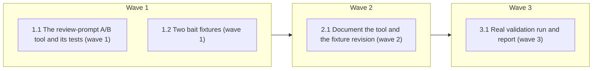

# A reusable runtime eval for the review prompts

<!-- AT-A-GLANCE:BEGIN (generated — do not edit; refreshed by render_plan.py --summarize) -->
## At a glance

**4 tasks · 3 waves · 13 files · 4/4 done**

| Wave | Task | Title | Files | Done (acceptance) |
|---|---|---|---|---|
| 1 | 1.1 | The review-prompt A/B tool and its tests (wave 1) | scripts/run_review_prompt_eval.py, scripts/test_run_review_prompt_eval.py | SC-1 through SC-5 exit 0; the tests make no model call; the tool imports no scra… |
| 1 | 1.2 | Two bait fixtures (wave 1) | evals/skills/review-chain/fixtures/bait-style-naming/intent.md, evals/skills/review-chain/fixtures/bait-style-naming/diff.patch, evals/skills/review-chain/fixtures/bait-style-naming/truth.md, evals/skills/review-chain/fixtures/bait-style-naming/truth.json, evals/skills/review-chain/fixtures/bait-generated-file/intent.md, evals/skills/review-chain/fixtures/bait-generated-file/diff.patch, evals/skills/review-chain/fixtures/bait-generated-file/truth.md, evals/skills/review-chain/fixtures/bait-generated-file/truth.json | SC-6 and SC-13 exit 0; each new directory holds exactly the four files; `core` i… |
| 2 | 2.1 | Document the tool and the fixture revision (wave 2) | evals/skills/review-chain/README.md | SC-8, SC-9 and SC-10 exit 0; the link to `specs/review-policy/runtime-eval.md` i… |
| 3 | 3.1 | Real validation run and report (wave 3) | specs/review-prompt-eval-tool/real-run.md, specs/review-prompt-eval-tool/real-run-results.json | SC-11 and SC-12 exit 0; the report states the total cost; no call was rerun. |



### Progress
- [x] 1.1 — The review-prompt A/B tool and its tests (wave 1)
- [x] 1.2 — Two bait fixtures (wave 1)
- [x] 2.1 — Document the tool and the fixture revision (wave 2)
- [x] 3.1 — Real validation run and report (wave 3)
<!-- AT-A-GLANCE:END -->

## 1. Motivation

The runtime A/B of the review prompts (`specs/review-policy/runtime-eval.md`, PR #288) ran from a driver kept in a
session scratchpad, measured no style or generated-file suppression, and ran each cell once. Per the approved
intent (`intent.md`): promote the driver to a tested `scripts/` tool, add bait fixtures, and record a variance
check with the new tool.

## 2. Non-goals

- No change to any review prompt, rule, skill or agent, to `score_review_chain_eval.py`, or to `run_review_chain_eval.py`.
- No CI wiring, no significance test, no rerun of the full 116-call comparison.
- E2 (`specs/hook-deny-route-lines`) is a separate item.

## 3. Success Criteria

| ID | Behavior (observable) | Check (re-runnable) | Expected |
|---|---|---|---|
| SC-1 | The tool's tests pass without any model call | `env PATH=/tmp/harness-tests-venv/bin:/usr/bin:/bin python3 -m pytest -q scripts/test_run_review_prompt_eval.py` | exit 0 |
| SC-2 | The base arm never receives text that exists only in the head revision | `env PATH=/tmp/harness-tests-venv/bin:/usr/bin:/bin python3 -m pytest -q scripts/test_run_review_prompt_eval.py -k arms_are_isolated` | exit 0 |
| SC-3 | A recorded call result is never overwritten and a rerun makes no new call for it | `env PATH=/tmp/harness-tests-venv/bin:/usr/bin:/bin python3 -m pytest -q scripts/test_run_review_prompt_eval.py -k never_overwrites` | exit 0 |
| SC-4 | The total budget cap stops new calls | `env PATH=/tmp/harness-tests-venv/bin:/usr/bin:/bin python3 -m pytest -q scripts/test_run_review_prompt_eval.py -k budget_cap` | exit 0 |
| SC-5 | The tool prints its usage and exits cleanly | `python3 scripts/run_review_prompt_eval.py --help` | exit 0 |
| SC-6 | The new bait fixtures pass the scorer's answer-key check together with the existing fixtures | `python3 scripts/score_review_chain_eval.py --check-truth evals/skills/review-chain/fixtures` | exit 0 |
| SC-7 | The existing scorer and runner tests are unchanged and pass | `env PATH=/tmp/harness-tests-venv/bin:/usr/bin:/bin python3 -m pytest -q scripts/test_score_review_chain_eval.py` | exit 0 |
| SC-8 | The README documents the tool | `grep -q run_review_prompt_eval.py evals/skills/review-chain/README.md` | exit 0 |
| SC-9 | The README records the fixture revision that adds the bait fixtures | `grep -q bait-style-naming evals/skills/review-chain/README.md` | exit 0 |
| SC-10 | The README documents the tool's budget cap | `grep -q max-total-usd evals/skills/review-chain/README.md` | exit 0 |
| SC-11 | The real run recorded at least 38 calls (28 bait, 10 variance) | `python3 -c "import json,sys;d=json.load(open('specs/review-prompt-eval-tool/real-run-results.json'));sys.exit(0 if len(d['records'])>=38 else 1)"` | exit 0 |
| SC-12 | The real-run report exists | `test -s specs/review-prompt-eval-tool/real-run.md` | exit 0 |
| SC-13 | Each bait fixture directory holds its four files | `python3 -c "import os,sys;d='evals/skills/review-chain/fixtures';sys.exit(0 if all(os.path.isfile(f'{d}/{n}/{f}') for n in ('bait-style-naming','bait-generated-file') for f in ('intent.md','diff.patch','truth.md','truth.json')) else 1)"` | exit 0 |

## Global Constraints

- Edit the source tree only. Never edit `.claude/`, `VERSION` or `CHANGELOG.md`. Touch only the files named in a task.
- Run shell commands as plain, separate commands from the worktree root; the session guard refuses compound
  commands, heredocs and inline scripts that mention git. Put helper scripts in a file.
- Run pytest with `/tmp/harness-tests-venv/bin` first on `PATH` (the system `python3` has no pytest), for example
  `env PATH=/tmp/harness-tests-venv/bin:/usr/bin:/bin python3 -m pytest -q <file>`.
- Tool tests make **no model call**: they use a stub `claude` executable. Follow the stub pattern in
  `scripts/test_score_review_chain_eval.py` (`STUB`, `make_stub`).
- **Read `drive.py` and `claude_call.py` in full before writing anything.** The input placeholders the tool replaces (the four finder inputs, the intent `## Inputs` block, the task `# Implementation` split, the task path substitutions, the `package.md` header) are copied verbatim from `drive.py` (`build`, `package_text`, `dispatch_block`); do not reinvent them.
- **Reference implementation** of the tool, to port and generalize (no hardcoded paths, no scratchpad imports):
  `/tmp/claude-1000/-home-minhtran-Documents-minh-tran-projects-agent-harness/95c7da2d-bbbf-4864-8644-c50195f593cd/scratchpad/rteval/`
  (`drive.py`, `claude_call.py`, `agg.py`, `CRITERIA.md`). It produced the 116-call run in
  `specs/review-policy/runtime-eval.md`; read that report's Method section too.
- **Facts the tool must respect** (each one cost a mistake or a wrong reading in the first run):
  - A call is `claude -p <prompt> --safe-mode --tools Read --allowedTools Read --model <m> --effort <e>
    --max-budget-usd <n> --output-format stream-json --verbose --no-session-persistence`, run with `cwd` set to a
    fresh temporary directory. Without `--safe-mode` and a clean `cwd` one trivial call cost $2.23; with them
    $0.02. Without `--allowedTools Read` a Read is denied (reported in `permission_denials`).
  - `stream-json` lines: `{"type":"assistant","message":{"content":[{"type":"tool_use","name":"Read","input":{"file_path":...}}]}}`
    and a final `{"type":"result","result":<text>,"total_cost_usd":<n>,"usage":{...},"permission_denials":[{"tool_input":{"file_path":...}}],"num_turns":<n>,"is_error":<bool>}`.
  - Each arm's prompts come from that revision's own files: extract `rules skills agents scripts/render_skill_prompt.py` of the revision with
    `git archive`, and run **that arm's own** `scripts/render_skill_prompt.py` **with `cwd` set to the arm's tree**. Its `--root`
    option does not select fragments, so running the repo's renderer from the repo would hand head text to both arms. The `arms_are_isolated` fixture repo must hold `scripts/render_skill_prompt.py` in both commits.
  - Each call's temporary `cwd` holds a copy of the arm's `rules/` and the fixture's `package.md` (the diff);
    nothing from an answer key (`truth.*`) may appear in a prompt or in that directory.
  - The dispatched prompt of an intent or task review is the block after `  prompt: |` up to the closing
    fence of the prompt file, dedented; the Inputs are replaced by filled-in ones. The audit prompt is the body of
    `skills/context-propagation-audit/SKILL.md` without frontmatter. Fail loudly (a clear error naming the file) if
    a prompt no longer has the expected shape.
  - Appended to finder, intent and audit prompts, identical in both arms (it replaces each prompt's own report
    format): `\n\n## Machine-readable output for this evaluation\n\nEnd your reply with your findings as a JSON array inside one fenced ```json block. Each finding is {"oracle": "<ORACLE>", "class": str, "file": str, "line": int|null, "confidence": int, "summary": str}, with confidence from 0 to 100. Use class `unknown` for anything you cannot confirm from the diff alone (for example a symbol defined outside it). Return an empty array if you find nothing. Your usual report format may precede the block.\n`
    with `<ORACLE>` set to `correctness`, `intent` or `context-propagation-audit`. Appended to task-reviewer prompts:
    `\n\nThe fixture statements are the complete provided evidence: do not demand files that the fixture does not claim to provide. Use \`cannot_verify\` only when the fixture explicitly says an external contract is unavailable.\n`
  - Results are first-run only: write each call's record with exclusive creation (`open(path, "x")`), skip a call
    whose record exists, and never rerun a miss. Retry only a call that failed to run at all (non-zero exit and no
    text), once. A later attempt gets its own record name.
- New fixtures follow the existing four-file layout (`intent.md`, `diff.patch`, `truth.md`, `truth.json`) and the
  answer-key rules in `evals/skills/review-chain/README.md`: exactly one planted defect, answerable from the
  fixture's own files.
- Do not use the words `correctly`, `properly`, `as expected`, `works`, `is correct`, `looks right`,
  `appropriate` or `reasonable` in a `Verify:` or `Done:` line (`rules/terminology.md` §3).

## 4. Tasks

### Task 1.1 — The review-prompt A/B tool and its tests (wave 1)

- **Files:** scripts/run_review_prompt_eval.py, scripts/test_run_review_prompt_eval.py
- **Action:** Write the tests first against the interface below, with a stub `claude`, then the tool. Interface:
  `python3 scripts/run_review_prompt_eval.py run --base-rev REV --head-rev REV --out DIR [--repo PATH]
  [--kinds finder,intent,audit,task] [--review-fixtures DIR] [--task-fixtures DIR] [--only-fixture NAME]...
  [--attempt N] [--model M] [--effort E] [--claude CMD] [--workers N] [--max-call-usd X] [--max-total-usd X]
  [--watch-path REL]` and `python3 scripts/run_review_prompt_eval.py report --out DIR [--review-fixtures DIR]
  [--task-fixtures DIR] [--watch-path REL]`. Defaults: repo = the current git toplevel; review fixtures =
  `evals/skills/review-chain/fixtures`; task fixtures = `evals/skills/task-review/fixtures`; model
  `claude-opus-5-5`, effort `medium`, workers 4, `--max-call-usd 1.5`, `--max-total-usd 20`, `--watch-path
  rules/review-policy.md`, attempt 1. Behavior: `run` builds the two arms, derives the finder angles from each
  arm's `skills/correctness-review/review-config.json`, runs finder (six angles) and intent on every review fixture,
  audit on fixtures whose `truth.json` has `expected_oracle` `context-propagation-audit`, and task on every task
  fixture, interleaving the arms; it writes `DIR/meta.json` (revisions, model, effort, flags; refuse to run into a
  directory whose `meta.json` differs) and one record per call under `DIR/runs/` named
  `<arm>__<kind>__<fixture>__<angle>__a<attempt>.json`, holding the job, rc, elapsed, cost, usage, reads,
  permission denials, `prompt_words` and the reply text. `report` prints, per arm: calls, calls with a parseable JSON
  block, share of calls that Read the watch path per kind, permission denials, cost, output tokens; then the
  scorer's summary for the attempt-1 review-chain records (write `DIR/result-<arm>.json` in the format
  `score_review_chain_eval.py --score` reads, one merged JSON block per fixture with each finding's `oracle`
  set from the call kind, and import the scorer's functions rather than copying them); then, per task fixture and
  arm, the labels from `score_task_review_eval.labels` for every attempt and whether the fixture's `truth.json`
  requirements hold. `--only-fixture NAME` is valid when NAME exists in any selected kind's fixture set. `report` scores only the fixtures that have records and skips a section that has none (so a task-only or bait-only directory reports without "not run" noise or a failing exit). Errors print one line prefixed `review-prompt-eval:` and exit 1.
  Tests (names must contain these words so SC-2..SC-4 select them): `arms_are_isolated` (a temp git repo with two
  commits whose finder fragment differs; the base arm's prompt, read from the stub's argument log, lacks the
  head-only text and the head arm's contains it), `never_overwrites` (a second run makes no stub call and leaves
  the record bytes unchanged), `budget_cap` (the stub reports a cost above `--max-total-usd`; later calls are
  skipped and the tool says so), plus: Read of the watch path is counted from the stub's `tool_use`, a reply with
  no JSON block is counted as unparseable and does not stop the run, a permission denial is reported, `meta.json`
  mismatch is refused, and `report` produces the scorer-format files, and no file named `truth.*` and no answer-key text is in a call's `cwd` or prompt.
- **Verify:** `env PATH=/tmp/harness-tests-venv/bin:/usr/bin:/bin python3 -m pytest -q scripts/test_run_review_prompt_eval.py`
- **Done:** SC-1 through SC-5 exit 0; the tests make no model call; the tool imports no scratchpad path.
- **Criteria:** SC-1, SC-2, SC-3, SC-4, SC-5
- **Interfaces:** Consumes the existing prompt renderer and the two existing scorers (imported, unchanged). Produces `scripts/run_review_prompt_eval.py` and `scripts/test_run_review_prompt_eval.py`.

### Task 1.2 — Two bait fixtures (wave 1)

- **Files:** evals/skills/review-chain/fixtures/bait-style-naming/intent.md, evals/skills/review-chain/fixtures/bait-style-naming/diff.patch, evals/skills/review-chain/fixtures/bait-style-naming/truth.md, evals/skills/review-chain/fixtures/bait-style-naming/truth.json, evals/skills/review-chain/fixtures/bait-generated-file/intent.md, evals/skills/review-chain/fixtures/bait-generated-file/diff.patch, evals/skills/review-chain/fixtures/bait-generated-file/truth.md, evals/skills/review-chain/fixtures/bait-generated-file/truth.json
- **Action:** Read two existing fixtures (`missing-await`, `intent-gap`) for the format, then add two fixtures. Each has
  `core: false`, `expected_oracle: "correctness"`, `correctness_clean: false`, one planted runtime bug that a
  careful reviewer can name from the diff and the request alone, and bait the policy's do-not-report list is meant to
  keep out. `bait-style-naming`: a small Python feature whose diff also holds only style, naming, formatting and
  maintainability issues (single-letter and vague names, an over-long line, inconsistent quoting, a missing
  docstring, a TODO comment) and no second runtime defect. `bait-generated-file`: a small Python source change with
  the planted bug, plus changes to two generated files that look suspicious but are generated output: a rendered
  `specs/demo/PLAN.html` (with inline script and style) and a `uv.lock` (version and hash churn); the policy
  excludes both. In `truth.json`, `false_positives` patterns match findings that report the bait (by file and
  terms such as naming, docstring, line length, formatting, quoting, todo; lock, hash, version, pin, script, xss,
  generated), and the planted pattern shares no term with the bait patterns so the scorer classifies the planted
  finding first. The scorer matches case-insensitive substrings of `class + summary`, and with `correctness_clean`
  false an unmatched bait finding is `other`, not a false positive, so pattern coverage is the whole measurement:
  bind each bait pattern to its file through the `file` field (`uv.lock`, `specs/demo/PLAN.html`, the source
  file), use full words or multi-word phrases rather than short stems such as `pin`, `lock` or `script`, and list
  every pattern's intent in `truth.md`. `truth.md` states the planted defect, what a false positive looks like, and that the bait is
  deliberately not a defect.
- **Verify:** `python3 scripts/score_review_chain_eval.py --check-truth evals/skills/review-chain/fixtures`
- **Done:** SC-6 and SC-13 exit 0; each new directory holds exactly the four files; `core` is false in both `truth.json` files, so the existing core counts do not change.
- **Criteria:** SC-6, SC-13
- **Interfaces:** Consumes the answer-key schema of the existing review-chain scorer (read-only). Produces `evals/skills/review-chain/fixtures/bait-style-naming/truth.json` and `evals/skills/review-chain/fixtures/bait-generated-file/truth.json` with their three sibling files each.

### Task 2.1 — Document the tool and the fixture revision (wave 2)

- **Files:** evals/skills/review-chain/README.md
- **Action:** Add a section "Runtime A/B of the real prompts" after "Scripted path": what the tool measures and why the
  earlier runners do not (they send their own hardcoded prompts), the two commands with an example for a base and a
  head revision, the conditions it fixes (model, effort, safe-mode, Read only, per-call budget), the records and
  report it writes, the honesty rules it enforces (first-run only, never overwritten, later attempts recorded
  separately), its cost scale (about $0.05 to $0.11 a call), and that it is manual and not part of CI. Add a
  fixture revision entry "v5 (2026-10-12)" under "Fixture revisions" naming `bait-style-naming` and
  `bait-generated-file`, stating they are `core: false`, and that results on the totals before v5 are not
  comparable. Link `specs/review-policy/runtime-eval.md` as the first run's report.
- **Verify:** `grep -q run_review_prompt_eval.py evals/skills/review-chain/README.md`
- **Done:** SC-8, SC-9 and SC-10 exit 0; the link to `specs/review-policy/runtime-eval.md` is written with a note that it resolves once PR #288 merges.
- **Criteria:** SC-8, SC-9, SC-10
- **Interfaces:** Consumes the tool interface from Task 1.1 and the fixture names from Task 1.2. Produces the updated `evals/skills/review-chain/README.md`.

### Task 3.1 — Real validation run and report (wave 3)

- **Files:** specs/review-prompt-eval-tool/real-run.md, specs/review-prompt-eval-tool/real-run-results.json
- **Action:** Use the finished tool for two real runs with the same model and effort as the first run, in an output
  directory outside the repo. (1) Bait: `run --base-rev 33d6ed4 --head-rev 0bd1ae6 --kinds finder,intent
  --only-fixture bait-style-naming --only-fixture bait-generated-file --max-total-usd 10` (28 calls), then `report`.
  (2) Variance: for each attempt 2 to 6, `run --base-rev 33d6ed4 --head-rev 0bd1ae6 --kinds task
  --only-fixture minor-only --attempt <n> --max-total-usd 3` into a second directory (10 calls), then `report`.
  Revision `0bd1ae6` is the tip of `feat/review-policy`; its prompts are identical to `f23e4ac`, which the first run used (`git diff f23e4ac 0bd1ae6 -- rules skills agents` is empty). The first run's report and results are not in this worktree; read them with `git show feat/review-policy:specs/review-policy/runtime-eval.md` and `git show feat/review-policy:specs/review-policy/runtime-eval-results.json`. Write `real-run-results.json` with the same shape as that results file (keys `revisions`, `environment`, `records`; each record: `arm`, `kind`, `fixture`, `angle`, `rc`, `elapsed_s`, `cost_usd`, `output_tokens`, `prompt_words`, `reads`, `permission_denials`, and `findings` or the task `reply`; no prompts). Write `real-run.md`:
  method in two sentences, the numbers per arm (bait findings by class, planted-bug catches, policy Read rate;
  for `minor-only` the labels of each attempt and whether the requirement held), the first run's `minor-only`
  outcome for comparison (base: the forbidden `spec_fail` label appeared; head: it did not), what the data
  supports and does not (counts only, no significance claim), and the total cost. Report a result that looks bad
  for the rewrite as plainly as a good one; do not rerun a call to change an outcome.
- **Verify:** `python3 -c "import json,sys;d=json.load(open('specs/review-prompt-eval-tool/real-run-results.json'));sys.exit(0 if len(d['records'])>=38 else 1)"`
- **Done:** SC-11 and SC-12 exit 0; the report states the total cost; no call was rerun.
- **Criteria:** SC-11, SC-12
- **Interfaces:** Consumes `scripts/run_review_prompt_eval.py` (Task 1.1) and the bait fixtures (Task 1.2). Produces `specs/review-prompt-eval-tool/real-run-results.json` and `specs/review-prompt-eval-tool/real-run.md`.

## 5. Risks

- The tool is coupled to the shape of the review prompts (a `prompt: |` block, an Inputs list). A later prompt
  change can break it; it fails with a named-file error instead of running a wrong prompt. The README says so.
- A bait pattern can miss a worded variant of a bait finding, or match a real one. `truth.md` explains each
  pattern; the real run reports findings by class so a reader can see what was counted.
- Single attempts are noisy. The variance check reports counts for 5 more attempts; it does not support a
  significance claim.
- Real runs spend money. Per-call and total caps are on by default; Task 3.1 passes explicit total caps.

## 6. Status Log

- 2026-10-12 — plan written from intent.md (approved 2026-10-12).
- 2026-10-12 — tasks 1.1, 1.2 complete; commits 2f1e229, c9a8126, 339250c (tool and fix rounds), c7c34f6, a075cbd (fixtures and fix round)
- 2026-10-12 — task 2.1 complete; commits de25429, 9a047b5 (README and fix round)
- 2026-10-12 — task 3.1 complete (run by the controller, not dispatched: it spends model money); real run recorded in real-run.md and real-run-results.json, 38 calls, $2.95
