# Adopt ASD-STE100 for harness prose (Phases 1–2)

<!-- AT-A-GLANCE:BEGIN (generated — do not edit; refreshed by render_plan.py --summarize) -->
## At a glance

**10 tasks · 6 waves · 34 files · 10/10 done**

| Wave | Task | Title | Files | Done (acceptance) |
|---|---|---|---|---|
| 1 | 1.1 | Vendor asd-ste100 into skills/ (wave 1) | skills/asd-ste100/SKILL.md, skills/asd-ste100/LICENSE, skills/asd-ste100/UPSTREAM.md, skills/asd-ste100/references/writing-rules.md, skills/asd-ste100/examples/before-after.md, skills/asd-ste100/scripts/ste-lint.py, harness-manifest.json, skills/README.md | Verify exits 0. `test ! -e .agents` exits 0. `python3 skills/asd-ste100/scripts/… |
| 1 | 2.1 | Pilot runner, probes, and intake fixtures (wave 1) | specs/ste100-harness-prose/experiment/pilot.py, specs/ste100-harness-prose/experiment/probes.json, specs/ste100-harness-prose/experiment/intake-fixtures.json, specs/ste100-harness-prose/experiment/README.md, specs/ste100-harness-prose/experiment/runs/smoke/ | Verify exits 0. `python3 specs/ste100-harness-prose/experiment/pilot.py --dry-ru… |
| 2 | 1.2 | Warn-only baseline ratchet (wave 2) | scripts/check_ste_baseline.py, scripts/test_check_ste_baseline.py, scripts/ste-baseline.json, scripts/run-tests.sh | Verify exits 0. `python3 scripts/check_ste_baseline.py --strict` exits 0. `grep … |
| 2 | 1.3 | STE lint counts in the review package (wave 2) | skills/subagent-driven-development/scripts/review_package.py, skills/subagent-driven-development/scripts/test_review_package.py | Verify exits 0. `/tmp/harness-tests-venv/bin/python -m pytest skills/subagent-dr… |
| 2 | 1.4 | Wire asd-ste100 into SDD and compound (wave 2) | skills/subagent-driven-development/implementer-prompt.md, skills/subagent-driven-development/task-reviewer-prompt.md, skills/subagent-driven-development/SKILL.md, skills/compound/SKILL.md, tests/scripts/context-propagation-regression.test.sh | Verify exits 0. `bash tests/scripts/compound-contract.test.sh` exits 0. `bash te… |
| 2 | 1.5 | Deploy smoke test for the vendored skill (wave 2) | tests/scripts/consumer-subset.test.sh, scripts/deploy-harness.sh | Verify exits 0 with the new assertions present (`grep -c asd-ste100 tests/script… |
| 3 | 1.6 | Vendored-skill exemption and wave-2 review fixes (wave 3) | scripts/audit_skill_prompts.py, scripts/test_audit_skill_prompts.py, skills/subagent-driven-development/scripts/review_package.py, skills/subagent-driven-development/scripts/test_review_package.py, scripts/check_ste_baseline.py, scripts/test_check_ste_baseline.py, skills/subagent-driven-development/SKILL.md, scripts/ste-baseline.json | Verify exits 0. `python3 scripts/audit_skill_prompts.py` exits 0. `python3 scrip… |
| 4 | 2.2 | Rewrite the three pilot files (wave 4) | rules/orchestration.md, skills/feature-intake/SKILL.md, skills/subagent-driven-development/SKILL.md, scripts/ste-baseline.json, specs/ste100-harness-prose/experiment/README.md, specs/ste100-harness-prose/experiment/probes.json | Verify exits 0. `python3 scripts/check_ste_baseline.py` exits 0 and prints a `NO… |
| 5 | 2.3 | Run the pilot and record the decision (wave 5) | specs/ste100-harness-prose/experiment/runs/pilot-1/, specs/ste100-harness-prose/DECISION.md, specs/ste100-harness-prose/QUESTIONS.md, rules/orchestration.md, skills/feature-intake/SKILL.md, skills/subagent-driven-development/SKILL.md, scripts/ste-baseline.json | Verify exits 0. `python3 specs/ste100-harness-prose/experiment/pilot.py --check-… |
| 6 | 2.4 | Re-sync this checkout's .claude/ (wave 6) | .claude/skills/asd-ste100/SKILL.md | Verify exits 0. `test -L .claude/skills/asd-ste100` exits 1 (a real directory, n… |

```mermaid
flowchart LR
  subgraph W0[Wave 1]
    T1_1["1.1 Vendor asd-ste100 into skills/ (wave 1)"]
    T2_1["2.1 Pilot runner, probes, and intake fixtures (wave 1)"]
  end
  subgraph W1[Wave 2]
    T1_2["1.2 Warn-only baseline ratchet (wave 2)"]
    T1_3["1.3 STE lint counts in the review package (wave 2)"]
    T1_4["1.4 Wire asd-ste100 into SDD and compound (wave 2)"]
    T1_5["1.5 Deploy smoke test for the vendored skill (wave 2)"]
  end
  subgraph W2[Wave 3]
    T1_6["1.6 Vendored-skill exemption and wave-2 review fixes (wave 3)"]
  end
  subgraph W3[Wave 4]
    T2_2["2.2 Rewrite the three pilot files (wave 4)"]
  end
  subgraph W4[Wave 5]
    T2_3["2.3 Run the pilot and record the decision (wave 5)"]
  end
  subgraph W5[Wave 6]
    T2_4["2.4 Re-sync this checkout's .claude/ (wave 6)"]
  end
  W0 --> W1
  W1 --> W2
  W2 --> W3
  W3 --> W4
  W4 --> W5
```

### Progress
- [x] 1.1 — Vendor asd-ste100 into skills/ (wave 1)
- [x] 2.1 — Pilot runner, probes, and intake fixtures (wave 1)
- [x] 1.2 — Warn-only baseline ratchet (wave 2)
- [x] 1.3 — STE lint counts in the review package (wave 2)
- [x] 1.4 — Wire asd-ste100 into SDD and compound (wave 2)
- [x] 1.5 — Deploy smoke test for the vendored skill (wave 2)
- [x] 1.6 — Vendored-skill exemption and wave-2 review fixes (wave 3)
- [x] 2.2 — Rewrite the three pilot files (wave 4)
- [x] 2.3 — Run the pilot and record the decision (wave 5)
- [x] 2.4 — Re-sync this checkout's .claude/ (wave 6)
<!-- AT-A-GLANCE:END -->

## 1. Motivation

Harness prose that agents execute (skills, rules, agents, dispatch prompts) has 329 hard
`ste-lint` findings in 16,501 words (measured 2026-10-14 ste-lint 0.4.0). This plan adopts the
`asd-ste100` skill for new prose, adds a warn-only linter ratchet, and pilots a rewrite of three
files behind a measured gate. Design: `specs/ste100-harness-prose/design.md` (D1–D7). Research:
`research-brief.md`. Phase 3 (rollout to the remaining files) is a later revision of this plan,
written only after `DECISION.md` records a pilot pass.

## 2. Non-goals

- Phase 3 rollout. No file outside the three pilot files gets an STE rewrite in this plan.
- Rewriting `CLAUDE.md`, `templates/`, existing `docs/solutions/` entries, or `specs/`.
- A blocking STE gate, a `PostToolUse` hook, or any change to `settings.json` or `hooks/`.
- Vendoring upstream `README.md` or `examples/linter-edge-cases.md`.
- Changing any behavior that the rewritten prose describes.

## Global Constraints

- Branch `docs/ste100-harness-prose`, cut from `sdlc`. PR base is `sdlc`.
- Vendor from upstream `danyuchn/asd-ste100-skill` commit `3944283c18`. The only allowed
  differences from upstream are: (1) an `allowed-tools: Read, Bash(python3 *)` frontmatter line,
  (2) `README.md` and `examples/linter-edge-cases.md` are not vendored, (3) the `scripts/ste-lint.py`
  path form in `SKILL.md`, changed only as far as `scripts/lint-doc-truth.sh` needs. List each one in
  `skills/asd-ste100/UPSTREAM.md`.
- Linter location everywhere: `skills/asd-ste100/scripts/ste-lint.py`. Scripts find it relative to
  their own file, never from the current directory.
- "Hard count" means the `hard_count` field of `ste-lint.py --json`. Advisory findings never count.
- `scripts/check_ste_baseline.py` default run always exits 0 and never blocks a build or a
  commit (D5). `--strict` exits 1 on a `WARN`. Only SC-6, task Done checks, and tests use it.
- The review package section heading is exactly `## STE lint`. When the linter cannot run, the
  section holds one line that starts `ste-lint: unavailable (`.
- Prose that a task writes or edits under `skills/`, `rules/`, `agents/` follows asd-ste100
  STE-flavored mode. Never edit fenced code, `### Intent`, or `intent.md`. Never change a literal
  string that a file under `tests/` or `hooks/` matches. Find those strings first:
  `grep -rn "<phrase>" tests hooks`.
- Never loosen a test to make a rewrite pass.
- Python tests on this machine run with `/tmp/harness-tests-venv/bin/python` (created by
  `bash -c 'source tests/lib.sh; ensure_pyenv'`). System `python3` has no pytest.
- Pilot trials run `claude -p --safe-mode --no-session-persistence --output-format json
  --max-budget-usd 0.50` in a fresh temp directory per trial. Total pilot spend cap: $25 (budget).
  Scoring reads files on disk only, never the model's reply text.
- `bash scripts/run-tests.sh` (full suite) runs at `finishing-a-development-branch`, not in a task
  Verify.

## 3. Success Criteria

| ID | Behavior (observable) | Check (re-runnable) | Expected |
|------|-------------------------|-----------------------|------------|
| SC-1 | The vendored skill is in the skill inventory and passes the allowed-tools check | `bash -c 'python3 scripts/check_manifest.py && bash scripts/check-allowed-tools.sh'` | exit 0 |
| SC-2 | The vendored skill passes the runtime-neutral scan and the doc-truth lint | `bash -c 'python3 scripts/check_runtime_neutral_sources.py && bash scripts/lint-doc-truth.sh'` | exit 0 |
| SC-3 | The `npx skills` install is gone from the repo | `bash -c 'test ! -e .agents && test ! -e skills-lock.json'` | exit 0 |
| SC-4 | The vendored linter's self-test passes | `python3 skills/asd-ste100/scripts/ste-lint.py --selftest` | exit 0 |
| SC-5 | The baseline checker warns above baseline, notes below baseline, handles missing, deleted and crash cases, and always exits 0 | `/tmp/harness-tests-venv/bin/python -m pytest scripts/test_check_ste_baseline.py -q` | exit 0 |
| SC-6 | No prose file is above its baseline (`--strict` turns a `WARN` into exit 1; the default run used by `run-tests.sh` still always exits 0) | `python3 scripts/check_ste_baseline.py --strict` | exit 0 |
| SC-7 | The review package adds a `## STE lint` section with BASE and HEAD hard counts for changed prose files, and an `unavailable` line when the linter fails | `/tmp/harness-tests-venv/bin/python -m pytest skills/subagent-driven-development/scripts/test_review_package.py -q` | exit 0 |
| SC-8 | The implementer prompt, the task reviewer prompt, `compound`, and the SDD controller each carry their asd-ste100 instruction, and deleting any one fails the test | `bash tests/scripts/context-propagation-regression.test.sh` | exit 0 |
| SC-9 | A deployed consumer tree has the skill and its linter, and has neither the upstream `README.md` nor `examples/linter-edge-cases.md` | `bash tests/scripts/consumer-subset.test.sh` | exit 0 |
| SC-10 | Pilot scoring logic passes its self-test on synthetic records | `python3 specs/ste100-harness-prose/experiment/pilot.py --selftest` | exit 0 |
| SC-11 | Pilot metrics re-derive from stored raw output without model calls | `python3 specs/ste100-harness-prose/experiment/pilot.py --score-only --output specs/ste100-harness-prose/experiment/runs/pilot-1` | exit 0 |
| SC-12 | Tests that read the pilot files still pass after the rewrite | `bash -c 'bash tests/scripts/sdd-artifact-handoffs.test.sh && bash tests/scripts/sdd-task-review-routing.test.sh && bash tests/scripts/run-state-chain-validation.test.sh && bash tests/scripts/runtime-entry-bindings.test.sh'` | exit 0 |
| SC-13 | OQ-1 is closed (the check blocks on an open question) | `bash -c 'REQUIRE_QUESTIONS_CLOSED=1 python3 .claude/scripts/check_open_questions.py --slug ste100-harness-prose'` | exit 0 |
| SC-14 | `DECISION.md` has one `PASS` or `FAIL` verdict line for each of the three pilot files, equal to the scorer's output | `python3 specs/ste100-harness-prose/experiment/pilot.py --check-decision specs/ste100-harness-prose/DECISION.md --output specs/ste100-harness-prose/experiment/runs/pilot-1` | exit 0 |
| SC-16 | The skill prompt audit passes, and it reports the vendored skill as exempt from the word ceiling | `python3 scripts/audit_skill_prompts.py` | exit 0 |
| SC-15 | One real headless trial per method leaves an output file that parses | `python3 specs/ste100-harness-prose/experiment/pilot.py --check-parse --output specs/ste100-harness-prose/experiment/runs/smoke` | exit 0 |

## 4. Tasks

### Task 1.1 — Vendor asd-ste100 into skills/ (wave 1)

- **Files:** skills/asd-ste100/SKILL.md, skills/asd-ste100/LICENSE, skills/asd-ste100/UPSTREAM.md, skills/asd-ste100/references/writing-rules.md, skills/asd-ste100/examples/before-after.md, skills/asd-ste100/scripts/ste-lint.py, harness-manifest.json, skills/README.md
- **Action:** Copy `SKILL.md`, `LICENSE`, `references/writing-rules.md`, `examples/before-after.md`,
  and `scripts/ste-lint.py` from `.agents/skills/asd-ste100/` into `skills/asd-ste100/`. First
  confirm the copy matches upstream: `sha256sum` of `SKILL.md` starts `39940a0db3d1` and of
  `ste-lint.py` starts `32263de1b6b7`. Apply the three deltas from Global Constraints. If a frontmatter check in Verify rejects an upstream key (for example `version:`), stop and report it (Rule 4): removing it would be a fourth delta. For delta 3,
  run `bash scripts/lint-doc-truth.sh` and change the path form only until it passes. Write
  `UPSTREAM.md`: source repo, commit `3944283c18`, version 0.4.0, the three deltas, and the
  re-vendor steps. Add `asd-ste100` to `harness-manifest.json` `skills`. Add one row to the
  `skills/README.md` inventory, written in STE-flavored mode. Delete `.agents/` and
  `skills-lock.json` (both untracked). Delete the dangling `.claude/skills/asd-ste100` symlink before running Verify:
  `check-plugin-validate.sh` fails while it exists.
- **Verify:** `bash -c 'python3 scripts/check_manifest.py && bash scripts/check-allowed-tools.sh && python3 scripts/check_runtime_neutral_sources.py && bash scripts/lint-doc-truth.sh && python3 scripts/check_frontmatter_contract.py && python3 scripts/check_skill_tool_conformance.py && bash scripts/lint-skill-bash.sh && bash scripts/check-plugin-validate.sh'`
- **Done:** Verify exits 0. `test ! -e .agents` exits 0. `python3 skills/asd-ste100/scripts/ste-lint.py --selftest` exits 0.
- **Criteria:** SC-1, SC-2, SC-3, SC-4
- **Interfaces:** Consumes the untracked npx-skills copy under .agents/skills/asd-ste100/ and upstream commit 3944283c18. Produces `skills/asd-ste100/scripts/ste-lint.py` (the linter every later task calls), `skills/asd-ste100/SKILL.md`, `skills/asd-ste100/UPSTREAM.md`, and the `harness-manifest.json` entry.

### Task 2.1 — Pilot runner, probes, and intake fixtures (wave 1)

- **Files:** specs/ste100-harness-prose/experiment/pilot.py, specs/ste100-harness-prose/experiment/probes.json, specs/ste100-harness-prose/experiment/intake-fixtures.json, specs/ste100-harness-prose/experiment/README.md, specs/ste100-harness-prose/experiment/runs/smoke/
- **Action:** Test-first: write `--selftest` cases for the scorer before the runner. Model
  `pilot.py` on `specs/ste-terminology-evidence/experiment/rerun.py` (fixture builder, `run_trial`,
  `observe`, `--score-only`). Arms: `original` reads each pilot file with
  `git show <base>:<path>`, where `<base>` is a `--base` argument. `rewritten` reads the working
  tree. Each trial copies the arm's file into a fresh temp directory and runs the CLI with the
  flags in Global Constraints.
  - Probes: write `probes.json` with 8 questions per pilot file (budget): `rules/orchestration.md`,
    `skills/feature-intake/SKILL.md`, `skills/subagent-driven-development/SKILL.md`. At least 4 per
    file (budget) need an exception, a condition, or a break-glass path to answer. Each question
    has one short gold answer taken from the current file. Task 2.2 re-checks the gold answers
    against the pilot base. One trial answers all 8 questions into `answers.json`. Run 10
    trials per arm per file (budget).
  - Workflow: write `intake-fixtures.json` with 8 requests (budget) and gold `Lane`, `Confidence`,
    `Escalate` values. Cover tiny, normal, high-risk, a hard gate, and a low-confidence case. The
    trial gets the arm's `feature-intake` SKILL.md plus `harness-manifest.json` and
    `rules/orchestration.md` (same arm), and it follows classification Steps 2–4 only. It writes
    `classification.json`. One trial classifies all 8 fixtures. Run 10 trials per arm (budget).
  - Scoring: a missing or unparsable output file scores every answer in that trial as wrong.
    Apply the pass rule from `design.md` §Phase 2: aggregate rewritten ≥ original − 2 correct
    answers, and the meaning-change rule for probes (10/10 → 7/10 or fewer fails). Print one
    verdict line per file: `<path>: PASS` or `<path>: FAIL (<rule>)`.
  - Flags: `--selftest`, `--dry-run` (builds one fixture directory and prints the command without
    calling the CLI), `--smoke` (one real trial per method at the per-trial cap), `--score-only`,
    `--check-parse` (exit 1 when any trial's output file is missing or does not parse; has a
    `--selftest` case), `--check-decision <DECISION.md>` (exit 1 unless the file has the same verdict line per pilot
    file as the scorer), `--output <dir>`, `--base <sha>`.
  - Run `--smoke --base HEAD --output specs/ste100-harness-prose/experiment/runs/smoke` once. In
    smoke mode both arms read from `git show HEAD:`, so the run does not depend on Task 1.1's
    parallel edits. Smoke spend counts toward the $25 pilot cap. If an
    output file does not parse, switch the trial prompt to the design's A1 fallback (a stripped
    classification prompt built from the skill text) and run the smoke again.
- **Verify:** `python3 specs/ste100-harness-prose/experiment/pilot.py --selftest`
- **Done:** Verify exits 0. `python3 specs/ste100-harness-prose/experiment/pilot.py --dry-run --base HEAD --output /tmp/ste-pilot-dry` exits 0 and prints a `claude -p` command that contains `--safe-mode` and `--max-budget-usd`. `python3 specs/ste100-harness-prose/experiment/pilot.py --check-parse --output specs/ste100-harness-prose/experiment/runs/smoke` exits 0.
- **Criteria:** SC-10, SC-15
- **Interfaces:** Consumes the three pilot files at a base sha and in the working tree, and `design.md` §Phase 2 pass rule. Produces `specs/ste100-harness-prose/experiment/pilot.py`, `probes.json`, `intake-fixtures.json`.

### Task 1.2 — Warn-only baseline ratchet (wave 2)

- **Files:** scripts/check_ste_baseline.py, scripts/test_check_ste_baseline.py, scripts/ste-baseline.json, scripts/run-tests.sh
- **Action:** Test-first: write `scripts/test_check_ste_baseline.py` with a fake linter and cases
  for: above baseline (`WARN`), below baseline (`NOTE`), a file missing from the baseline
  (baseline 0 plus `WARN`), a baseline entry for a deleted file (`WARN`), and a linter crash or
  invalid JSON (`ste-baseline: skipped (<reason>)`). Every case asserts exit 0. Then write
  `scripts/check_ste_baseline.py`: lint every `skills/*/*.md`, `skills/*/*/*.md`, `rules/*.md`,
  `agents/*.md` with `ste-lint.py --json`, compare each `hard_count` with
  `scripts/ste-baseline.json`, print the lines, exit 0. Hold the `--disable` rule list in one
  constant and use it for both checking and `--update` (which rewrites the baseline file). Add
  `--strict`: exit 1 when any `WARN` line prints (used only by SC-6, task Done checks, and tests). Before generating
  the baseline, review up to 5 hard findings per rule across the tree for false positives on
  tables or inline code. Disable a rule only when most sampled findings are false. Record the
  sample and the decision in a comment next to the constant. Add a
  `Verifies:` / `Does not verify:` header comment. Generate `scripts/ste-baseline.json` with
  `--update`. In `scripts/run-tests.sh`, add `python3 skills/asd-ste100/scripts/ste-lint.py --selftest`
  (a failure fails the suite) and `python3 scripts/check_ste_baseline.py` (report only).
- **Verify:** `/tmp/harness-tests-venv/bin/python -m pytest scripts/test_check_ste_baseline.py -q`
- **Done:** Verify exits 0. `python3 scripts/check_ste_baseline.py --strict` exits 0. `grep -c sampled scripts/check_ste_baseline.py` prints 1 or more.
- **Criteria:** SC-4, SC-5, SC-6
- **Interfaces:** Consumes `skills/asd-ste100/scripts/ste-lint.py` (Task 1.1). Produces `scripts/check_ste_baseline.py` and `scripts/ste-baseline.json` (Task 2.2 lowers its pilot entries).

### Task 1.3 — STE lint counts in the review package (wave 2)

- **Files:** skills/subagent-driven-development/scripts/review_package.py, skills/subagent-driven-development/scripts/test_review_package.py
- **Action:** Test-first: write `test_review_package.py` (pattern: `test_task_brief.py` in the same
  directory). Build a temp git repo with a BASE and HEAD commit. Cases: a changed `.md` under
  `skills/`, `rules/`, or `agents/` produces a `## STE lint` section with one line per file that
  shows the BASE and HEAD hard counts. A file new at HEAD shows `base: new`. No changed prose
  file produces no section. A broken linter produces `ste-lint: unavailable (<reason>)` and the
  script still exits 0. Then extend `review_package.py`: find the linter at
  `Path(__file__).resolve().parents[2] / "asd-ste100" / "scripts" / "ste-lint.py"`, held in a
  module-level constant `STE_LINT` that the broken-linter test monkeypatches. Lint each
  side from `git show <sha>:<path>` through stdin. Append the section after the diff. Keep the
  existing package content unchanged.
- **Verify:** `/tmp/harness-tests-venv/bin/python -m pytest skills/subagent-driven-development/scripts/test_review_package.py -q`
- **Done:** Verify exits 0. `/tmp/harness-tests-venv/bin/python -m pytest skills/subagent-driven-development/scripts/test_task_brief.py -q` exits 0.
- **Criteria:** SC-7
- **Interfaces:** Consumes `skills/asd-ste100/scripts/ste-lint.py` (Task 1.1). Produces `skills/subagent-driven-development/scripts/review_package.py` with the `## STE lint` section that Task 1.4's reviewer instruction reads.

### Task 1.4 — Wire asd-ste100 into SDD and compound (wave 2)

- **Files:** skills/subagent-driven-development/implementer-prompt.md, skills/subagent-driven-development/task-reviewer-prompt.md, skills/subagent-driven-development/SKILL.md, skills/compound/SKILL.md, tests/scripts/context-propagation-regression.test.sh
- **Action:** Test-first: add four assertions to `context-propagation-regression.test.sh`, each
  with a mutation case that deletes the instruction from a temp copy and expects a failure:
  1. The implementer prompt tells the implementer to apply `skills/asd-ste100/SKILL.md`
     (STE-flavored mode; Strict for dispatch prompts) to prose it changes under `skills/`,
     `rules/`, or `agents/`, with the exclusions from Global Constraints.
  2. The task reviewer prompt tells the reviewer to read the `## STE lint` section, to return a
     quality finding for any file whose HEAD hard count is above its BASE count, to treat a
     `base: new` line as a warning and not a finding, and to treat a missing section or an
     `ste-lint: unavailable` line as not a pass.
  3. `compound/SKILL.md` "Write canonical records" tells the writer to apply asd-ste100
     STE-flavored mode to each new record, with the same exclusions (fenced code, and literal
     strings that a test or hook matches).
  4. SDD `SKILL.md` tells the controller: when the `## STE lint` section is missing or
     unavailable, re-run `review_package.py` once, then report the task as blocked.
  Then add the four instructions. Keep each one short and in STE-flavored mode. Run
  `python3 scripts/render_skill_prompt.py --check-all` after the edits.
- **Verify:** `bash tests/scripts/context-propagation-regression.test.sh`
- **Done:** Verify exits 0. `bash tests/scripts/compound-contract.test.sh` exits 0. `bash tests/scripts/sdd-task-review-routing.test.sh` exits 0. `python3 scripts/render_skill_prompt.py --check-all` exits 0.
- **Criteria:** SC-8
- **Interfaces:** Consumes the `## STE lint` section contract (Global Constraints) and `skills/asd-ste100/SKILL.md` (Task 1.1). Produces the four instructions in `skills/subagent-driven-development/implementer-prompt.md`, `skills/subagent-driven-development/task-reviewer-prompt.md`, `skills/subagent-driven-development/SKILL.md`, `skills/compound/SKILL.md`.

### Task 1.5 — Deploy smoke test for the vendored skill (wave 2)

- **Files:** tests/scripts/consumer-subset.test.sh, scripts/deploy-harness.sh
- **Action:** Test-first: in `consumer-subset.test.sh`, assert that the derived consumer tree has
  `.claude/skills/asd-ste100/SKILL.md` and `.claude/skills/asd-ste100/scripts/ste-lint.py`, that
  `.claude/skills/asd-ste100/README.md` and `.claude/skills/asd-ste100/examples/linter-edge-cases.md`
  do not exist, and that the derived `SKILL.md` has no path to `ste-lint.py` that is wrong in a
  consumer (same idea as the existing `render_plan.py` deployed-path check in the same file). If an assertion fails, fix the cause in `scripts/deploy-harness.sh` only after a
  Rule 4 STOP, because that file is outside this task's Files.
- **Verify:** `bash tests/scripts/consumer-subset.test.sh`
- **Done:** Verify exits 0 with the new assertions present (`grep -c asd-ste100 tests/scripts/consumer-subset.test.sh` prints 3 or more).
- **Criteria:** SC-9
- **Interfaces:** Consumes `skills/asd-ste100/SKILL.md` (Task 1.1) and the existing deploy script scripts/deploy-harness.sh. Produces assertions in `tests/scripts/consumer-subset.test.sh`.

### Task 1.6 — Vendored-skill exemption and wave-2 review fixes (wave 3)

- **Files:** scripts/audit_skill_prompts.py, scripts/test_audit_skill_prompts.py, skills/subagent-driven-development/scripts/review_package.py, skills/subagent-driven-development/scripts/test_review_package.py, scripts/check_ste_baseline.py, scripts/test_check_ste_baseline.py, skills/subagent-driven-development/SKILL.md, scripts/ste-baseline.json
- **Action:** Added after wave 2 by user decision (word ceiling: "Exempt vendored skills") and from Minor wave-2 review findings. Test-first for each code change.
  1. `audit_skill_prompts.py`: skip the word-ceiling check for a skill directory that holds `UPSTREAM.md`, and report it as `vendored, exempt`. Add a test with a fixture skill over the ceiling plus `UPSTREAM.md` (exempt) and one without it (still fails).
  2. `review_package.py`: pass `timeout=60` to the linter call, and treat `subprocess.TimeoutExpired`, `ValueError` (including `UnicodeDecodeError`) and `subprocess.SubprocessError` as linter failures that give the `ste-lint: unavailable (` line with exit 0. Add a hang test (a fake linter that sleeps past a patched short timeout) and assert the one-line section in the missing-linter test.
  3. `check_ste_baseline.py`: in `load_baseline`, raise `Skip` when a value is not an int (bools excluded). Add a test.
  4. SDD `SKILL.md`: replace the two-sentence bullet "If `## STE lint` counts for changed prose are missing or unavailable, re-run `review_package.py` once. If they still fail, report the task as blocked." with "If changed-prose `## STE lint` counts are missing or unavailable, re-run `review_package.py` once. If still missing or unavailable, report the task as blocked." (controller wording after review: it keeps the changed-prose scope and fits the 600-word ceiling). Keep the file at or under 600 words (`python3 scripts/audit_skill_prompts.py`). Do not change any other sentence.
  5. Regenerate `scripts/ste-baseline.json` with `python3 scripts/check_ste_baseline.py --update` from the committed tree.
- **Verify:** `/tmp/harness-tests-venv/bin/python -m pytest scripts/test_audit_skill_prompts.py scripts/test_check_ste_baseline.py skills/subagent-driven-development/scripts/test_review_package.py -q`
- **Done:** Verify exits 0. `python3 scripts/audit_skill_prompts.py` exits 0. `python3 scripts/check_ste_baseline.py --strict` exits 0 and prints no `NOTE` line. `bash tests/scripts/context-propagation-regression.test.sh` exits 0.
- **Criteria:** SC-16, SC-5, SC-6, SC-7, SC-8
- **Interfaces:** Consumes Tasks 1.1–1.4 outputs. Produces `scripts/audit_skill_prompts.py` with the vendored exemption, a hardened `skills/subagent-driven-development/scripts/review_package.py`, and a refreshed `scripts/ste-baseline.json` that Task 2.2 lowers.

### Task 2.2 — Rewrite the three pilot files (wave 4)

- **Files:** rules/orchestration.md, skills/feature-intake/SKILL.md, skills/subagent-driven-development/SKILL.md, scripts/ste-baseline.json, specs/ste100-harness-prose/experiment/README.md, specs/ste100-harness-prose/experiment/probes.json
- **Action:** Before editing, record the current `HEAD` sha as the pilot base in
  `specs/ste100-harness-prose/experiment/README.md`. Check each gold answer in `probes.json`
  against the three files at that sha. Wave 2 changed SDD `SKILL.md`, so fix any gold answer that
  no longer matches and note the change in the README. Then rewrite each pilot file with asd-ste100 STE-flavored mode. Follow every
  rule in Global Constraints for prose edits. Keep every condition, number, path, flag, and hedge.
  Do not change headings that other files link to (`grep -rn "<heading text>" skills rules agents
  tests`). Lower the three files' entries in `scripts/ste-baseline.json` with
  `python3 scripts/check_ste_baseline.py --update`, then revert any entry for a file outside
  these three. For each file, list in the task report every sentence you kept long on purpose
  and why. The task reviewer judges meaning equivalence per file in its spec verdict. The pilot
  (Task 2.3) measures it.
- **Verify:** `bash -c 'bash tests/scripts/sdd-artifact-handoffs.test.sh && bash tests/scripts/sdd-task-review-routing.test.sh && bash tests/scripts/run-state-chain-validation.test.sh && bash tests/scripts/runtime-entry-bindings.test.sh && bash tests/scripts/context-propagation-regression.test.sh'`
- **Done:** Verify exits 0. `python3 scripts/check_ste_baseline.py` exits 0 and prints a `NOTE` line for each of the three files, and `python3 scripts/check_ste_baseline.py --strict` exits 0.
- **Criteria:** SC-12, SC-6
- **Interfaces:** Consumes `skills/asd-ste100/SKILL.md`, `scripts/check_ste_baseline.py` (Task 1.2), and Task 1.4's edits to SDD `SKILL.md`. Produces rewritten `rules/orchestration.md`, `skills/feature-intake/SKILL.md`, `skills/subagent-driven-development/SKILL.md`.

### Task 2.3 — Run the pilot and record the decision (wave 5)

- **Files:** specs/ste100-harness-prose/experiment/runs/pilot-1/, specs/ste100-harness-prose/DECISION.md, specs/ste100-harness-prose/QUESTIONS.md, rules/orchestration.md, skills/feature-intake/SKILL.md, skills/subagent-driven-development/SKILL.md, scripts/ste-baseline.json
- **Action:** Run `python3 specs/ste100-harness-prose/experiment/pilot.py --base <pilot base sha> --output specs/ste100-harness-prose/experiment/runs/pilot-1`.
  Stop the run if total spend, including the smoke spend recorded in `runs/smoke/` cost fields, passes $25 (budget), and report it. Write `DECISION.md`: protocol,
  CLI version, models, cost, the per-file verdict lines, both metrics per file, and
  limitations. Close OQ-1 in `QUESTIONS.md` with the result. The last four Files entries change only on a fail. If any file fails: revert every Task
  2.2 commit (newest first) with `git revert`, say in `DECISION.md` that the pilot files now match the pilot
  base sha (not `a5d4292`, because Task 1.4 changed SDD `SKILL.md`), and record that Phase 3 does not run. In
  every case, stop and report to the user before any Phase 3 planning.
- **Verify:** `python3 specs/ste100-harness-prose/experiment/pilot.py --score-only --output specs/ste100-harness-prose/experiment/runs/pilot-1`
- **Done:** Verify exits 0. `python3 specs/ste100-harness-prose/experiment/pilot.py --check-decision specs/ste100-harness-prose/DECISION.md --output specs/ste100-harness-prose/experiment/runs/pilot-1` exits 0. `REQUIRE_QUESTIONS_CLOSED=1 python3 .claude/scripts/check_open_questions.py --slug ste100-harness-prose` exits 0.
- **Criteria:** SC-11, SC-13, SC-14
- **Interfaces:** Consumes `specs/ste100-harness-prose/experiment/pilot.py` (Task 2.1) and the rewritten files (Task 2.2). Produces `specs/ste100-harness-prose/DECISION.md` and raw runs under `specs/ste100-harness-prose/experiment/runs/pilot-1/`.

### Task 2.4 — Re-sync this checkout's .claude/ (wave 6)

- **Files:** .claude/skills/asd-ste100/SKILL.md
- **Action:** Run `bash scripts/deploy-harness.sh` on this checkout so `.claude/` matches the final
  sources, including the vendored skill and any revert from Task 2.3. `.claude/` is gitignored, so
  this task makes no commit.
- **Verify:** `test -f .claude/skills/asd-ste100/scripts/ste-lint.py`
- **Done:** Verify exits 0. `test -L .claude/skills/asd-ste100` exits 1 (a real directory, not the old symlink).
- **Criteria:** SC-9
- **Interfaces:** Consumes all earlier tasks and the existing deploy script scripts/deploy-harness.sh. Produces the derived `.claude/skills/asd-ste100/SKILL.md` (gitignored, not committed).

## 5. Risks

- `skills/`, `rules/`, `agents/` edits trip the `workflow-engine` warn-mode signal. `scripts/` edits trip the `ci-strict-gate.sh` warn tier. SUMMARY needs re-runnable high-risk `### Verify` rows and a context-propagation audit.
- A pilot file rewrite can break a literal-grep test that the Task 2.2 Verify list does not cover. The full suite at `finishing-a-development-branch` is the backstop.
- Probes written by the same agent that knows the rewrite can be easier than intended. Task 2.1 writes probes and gold answers before Task 2.2 rewrites anything.
- The pilot spends money through the CLI. The per-trial cap and the $25 total cap (budget) bound it.
- Task 1.5 may find a deploy-harness gap that needs a `scripts/deploy-harness.sh` change, which is outside its Files set (Rule 4 STOP).

### Assumption coverage

- A1 → SC-15
- A2 → SC-9
- A3 → SC-12
- A4 → SC-14
- A5 → SC-6

## 6. Status Log

- 2026-10-14 — proposed (writing-plans)
- 2026-10-14 — tasks 1.1, 2.1 complete; commits a4d596f (1.1), none for 2.1 (spec-dir files held uncommitted until SUMMARY covers every SC)
- 2026-10-14 — tasks 1.2, 1.3, 1.4, 1.5 complete; commits a7253ae, 89221a4, 2aeef17, 966ef3b. Task 1.6 added (user decision: exempt vendored skills from the word ceiling)
- 2026-10-14 — task 1.6 complete; commits 28dbfd4, 0cc7ab7
- 2026-10-14 — task 2.2 complete; commits f49a9d1, dc867ed, 87d204c (pilot base 0cc7ab7; two review fix rounds restored dropped conditions)
- 2026-10-14 — task 2.3 complete; no commit (all three pilot files PASS, no revert; DECISION.md, QUESTIONS.md OQ-1 closed, runs/pilot-1, $2.91 total spend)
- 2026-10-14 — task 2.4 complete; no commit (.claude/ re-synced, gitignored). User decision: ship Phases 1–2 in this PR; Phase 3 is a follow-up plan revision
- 2026-10-15 — final review chain: context-propagation audit PASS after repair f7e5dfe; correctness review 0 findings at threshold (8 advisory); intent review 6 findings, fixed in a7081fb (user excluded synonym-rotation) or recorded (A-partial and tiny lane deferred to Phase 3)
- 2026-10-15 — shipped (Phases 1–2): compound records 60c922a + 37122fd (docs delta reviewed, pass); receipt pinned at 37122fd; run-tests ALL GREEN (939 pytest) and ci-strict-gate OK against sdlc; PR to sdlc. Phase 3 is a follow-up plan revision
