# STE rollout to the remaining harness prose (Phase 3)

<!-- AT-A-GLANCE:BEGIN (generated — do not edit; refreshed by render_plan.py --summarize) -->
## At a glance

**14 tasks · 14 waves · 54 files · 14/14 done**

| Wave | Task | Title | Files | Done (acceptance) |
|---|---|---|---|---|
| 1 | 1.1 | Per-file ratchet against the start ref (wave 1) | scripts/check_ste_baseline.py, scripts/test_check_ste_baseline.py | Verify exits 0. `python3 scripts/check_ste_baseline.py --strict --against 48e7e0… |
| 2 | 1.2 | Scope-qualifier section in the review package (wave 2) | scripts/check_scope_qualifiers.py, scripts/test_check_scope_qualifiers.py, skills/subagent-driven-development/scripts/review_package.py, skills/subagent-driven-development/scripts/test_review_package.py | Verify exits 0. `/tmp/harness-tests-venv/bin/python -m pytest skills/subagent-dr… |
| 3 | 1.3 | Meaning-equivalence instruction for the task reviewer (wave 3) | skills/subagent-driven-development/task-reviewer-prompt.md, tests/scripts/context-propagation-regression.test.sh, scripts/ste-baseline.json | Verify exits 0. `python3 scripts/check_ste_baseline.py --strict --against 48e7e0… |
| 4 | 1.4 | Tiny-lane STE line in feature-intake (wave 4) | skills/feature-intake/SKILL.md, tests/scripts/context-propagation-regression.test.sh, scripts/ste-baseline.json | Verify exits 0. `python3 scripts/audit_skill_prompts.py` exits 0. `python3 scrip… |
| 5 | 1.5 | Rollout checker (wave 5) | specs/ste100-prose-rollout/check_rollout.py | Verify exits 0. `python3 specs/ste100-prose-rollout/check_rollout.py --frontmatt… |
| 6 | 2.1 | Rewrite B1: the three largest rules (wave 6) | rules/plan-format.md, rules/auto-correct-scope.md, rules/terminology.md, scripts/ste-baseline.json | Verify exits 0. `python3 specs/ste100-prose-rollout/check_rollout.py --task-scop… |
| 7 | 2.2 | Rewrite B2: the other rules (wave 7) | rules/behavior.md, rules/research-depth.md, rules/review-policy.md, rules/wave-parallelism.md, rules/architecture.md, scripts/ste-baseline.json | Verify exits 0. `python3 specs/ste100-prose-rollout/check_rollout.py --task-scop… |
| 8 | 2.3 | Rewrite B3: agents (wave 8) | agents/PROJECT.md, agents/README.md, agents/coding.md, agents/reviewer.md, agents/task-reviewer.md, agents/test-runner.md, scripts/ste-baseline.json | Verify exits 0. `python3 specs/ste100-prose-rollout/check_rollout.py --task-scop… |
| 9 | 2.4 | Rewrite B4: intake and planning references (wave 9) | skills/brainstorming/SKILL.md, skills/writing-plans/SKILL.md, skills/writing-plans/references/review-loop.md, skills/feature-intake/references/draft-intent.md, skills/feature-intake/references/re-pin.md, scripts/ste-baseline.json | Verify exits 0. `python3 specs/ste100-prose-rollout/check_rollout.py --task-scop… |
| 10 | 2.5 | Rewrite B5: xia2 (wave 10) | skills/xia2/SKILL.md, skills/xia2/README.md, skills/xia2/references/depth-classifier.md, scripts/ste-baseline.json, skills/xia2/tests/structural/depth-modes-test-cases.md | Verify exits 0. `python3 specs/ste100-prose-rollout/check_rollout.py --task-scop… |
| 11 | 2.6 | Rewrite B6: review skills and prompts (wave 11) | skills/correctness-review/SKILL.md, skills/correctness-review/correctness-reviewer-prompt.md, skills/correctness-review/correctness-scorer-prompt.md, skills/intent-review/SKILL.md, skills/intent-review/intent-reviewer-prompt.md, skills/context-propagation-audit/SKILL.md, scripts/ste-baseline.json | Verify exits 0. `python3 specs/ste100-prose-rollout/check_rollout.py --task-scop… |
| 12 | 2.7 | Rewrite B7: SDD prompts and references, worktrees (wave 12) | skills/subagent-driven-development/implementer-prompt.md, skills/subagent-driven-development/task-reviewer-prompt.md, skills/subagent-driven-development/references/resume.md, skills/subagent-driven-development/references/review-chain.md, skills/using-git-worktrees/SKILL.md, scripts/ste-baseline.json | Verify exits 0. `python3 specs/ste100-prose-rollout/check_rollout.py --task-scop… |
| 13 | 2.8 | Rewrite B8: finishing, retro, visual planner (wave 13) | skills/finishing-a-development-branch/SKILL.md, skills/finishing-a-development-branch/references/pr-body.md, skills/session-retro/SKILL.md, skills/visual-planner/SKILL.md, skills/visual-planner/references/review-sidecar.md, scripts/ste-baseline.json | Verify exits 0. `python3 specs/ste100-prose-rollout/check_rollout.py --task-scop… |
| 14 | 2.9 | Rewrite B9: compound (wave 14) | skills/compound/SKILL.md, skills/compound/README.md, skills/compound/subagents/context-analyzer-prompt.md, skills/compound/subagents/decision-extractor-prompt.md, skills/compound/subagents/related-docs-finder-prompt.md, scripts/ste-baseline.json | Verify exits 0. `python3 specs/ste100-prose-rollout/check_rollout.py --task-scop… |

```mermaid
flowchart LR
  subgraph W0[Wave 1]
    T1_1["1.1 Per-file ratchet against the start ref (wave 1)"]
  end
  subgraph W1[Wave 2]
    T1_2["1.2 Scope-qualifier section in the review package (wave 2)"]
  end
  subgraph W2[Wave 3]
    T1_3["1.3 Meaning-equivalence instruction for the task reviewer (wave 3)"]
  end
  subgraph W3[Wave 4]
    T1_4["1.4 Tiny-lane STE line in feature-intake (wave 4)"]
  end
  subgraph W4[Wave 5]
    T1_5["1.5 Rollout checker (wave 5)"]
  end
  subgraph W5[Wave 6]
    T2_1["2.1 Rewrite B1: the three largest rules (wave 6)"]
  end
  subgraph W6[Wave 7]
    T2_2["2.2 Rewrite B2: the other rules (wave 7)"]
  end
  subgraph W7[Wave 8]
    T2_3["2.3 Rewrite B3: agents (wave 8)"]
  end
  subgraph W8[Wave 9]
    T2_4["2.4 Rewrite B4: intake and planning references (wave 9)"]
  end
  subgraph W9[Wave 10]
    T2_5["2.5 Rewrite B5: xia2 (wave 10)"]
  end
  subgraph W10[Wave 11]
    T2_6["2.6 Rewrite B6: review skills and prompts (wave 11)"]
  end
  subgraph W11[Wave 12]
    T2_7["2.7 Rewrite B7: SDD prompts and references, worktrees (wave 12)"]
  end
  subgraph W12[Wave 13]
    T2_8["2.8 Rewrite B8: finishing, retro, visual planner (wave 13)"]
  end
  subgraph W13[Wave 14]
    T2_9["2.9 Rewrite B9: compound (wave 14)"]
  end
  W0 --> W1
  W1 --> W2
  W2 --> W3
  W3 --> W4
  W4 --> W5
  W5 --> W6
  W6 --> W7
  W7 --> W8
  W8 --> W9
  W9 --> W10
  W10 --> W11
  W11 --> W12
  W12 --> W13
```

### Progress
- [x] 1.1 — Per-file ratchet against the start ref (wave 1)
- [x] 1.2 — Scope-qualifier section in the review package (wave 2)
- [x] 1.3 — Meaning-equivalence instruction for the task reviewer (wave 3)
- [x] 1.4 — Tiny-lane STE line in feature-intake (wave 4)
- [x] 1.5 — Rollout checker (wave 5)
- [x] 2.1 — Rewrite B1: the three largest rules (wave 6)
- [x] 2.2 — Rewrite B2: the other rules (wave 7)
- [x] 2.3 — Rewrite B3: agents (wave 8)
- [x] 2.4 — Rewrite B4: intake and planning references (wave 9)
- [x] 2.5 — Rewrite B5: xia2 (wave 10)
- [x] 2.6 — Rewrite B6: review skills and prompts (wave 11)
- [x] 2.7 — Rewrite B7: SDD prompts and references, worktrees (wave 12)
- [x] 2.8 — Rewrite B8: finishing, retro, visual planner (wave 13)
- [x] 2.9 — Rewrite B9: compound (wave 14)
<!-- AT-A-GLANCE:END -->

## 1. Motivation

PR #293 (`specs/ste100-harness-prose/`) adopted ASD-STE100 for new prose and rewrote three pilot
files. The pilot passed (`specs/ste100-harness-prose/DECISION.md`). This plan rolls the rewrite out
to the other 43 agent-prose files (267 hard findings, measured 2026-10-15
`scripts/ste-baseline.json`). It first lands four guardrails, because the pilot rewrite dropped two
scope qualifiers that only a requested meaning review caught
(`docs/solutions/harness/ste-rewrite-drops-scope-qualifiers.md`). Design:
`specs/ste100-prose-rollout/design.md` (D1–D7). Research: `research-brief.md`.

## 2. Non-goals

- Eval fixtures (`skills/*/tests/*.md`), templates (`skills/*/templates/`,
  `agents/PROJECT.template.md`, `skills/brainstorming/references/design-template.md`,
  `skills/xia2/references/research-brief-template.md`), the vendored `skills/asd-ste100/`, the three
  pilot files except the A3 edit to `skills/feature-intake/SKILL.md`, and zero-count files.
- A new paid comprehension pilot.
- Deploying `scripts/check_scope_qualifiers.py` to consumers (user decision 2026-10-15:
  harness-only).
- Consumer `PROSE_ROOTS` scope, and making the qualifier section or the default baseline run
  blocking.
- Changing any behavior that the rewritten prose describes.

## Global Constraints

- Branch `docs/ste100-prose-rollout`, stacked on `docs/ste100-harness-prose`. The PR targets
  `docs/ste100-harness-prose` and is retargeted to `sdlc` after PR #293 merges.
- The start ref for every per-file comparison is `48e7e05`. If the branch is rebased onto a changed
  `docs/ste100-harness-prose`, re-pin it to the new merge-base in this plan, the SUMMARY and the SC
  table, and record it in `### Deviations`.
- Tasks run sequentially, one implementer and one task review each (design D5). Never run two
  implementers at once.
- Prose that a task writes or edits under `skills/`, `rules/`, `agents/` follows
  `skills/asd-ste100/SKILL.md` STE-flavored mode (Strict for dispatch prompts:
  `*-prompt.md`). Never edit YAML frontmatter, fenced code, `### Intent`, or `intent.md`.
  Exception, added 2026-10-15 after Task 1.3: in a `*-prompt.md` file, the fenced dispatch block
  (the `Task tool (...)` block that holds the prompt text) is prose. Rewrite its prompt text in
  Strict mode, but keep unchanged every command, path, placeholder (`[LIKE_THIS]`, `<like-this>`),
  YAML key and value, and the lines `description:`, `subagent_type:`, `model_stage:`, `prompt: |`.
  `ste-lint.py` skips fenced blocks, so the STE lint count does not cover this text; the task
  reviewer's meaning check and its Strict-mode judgement are the only checks for it. Never
  change a literal string that a file under `tests/` or `hooks/` matches. Find those strings first:
  `grep -rn "<phrase>" tests hooks scripts`.
- Keep every condition, exception, hedge, number, path and flag. When you split a sentence of the
  form "X if Y: A; B; C", repeat the condition on each part, or keep one lead sentence that names
  it for all parts. Never cut a condition word to meet the 600-word ceiling. At the ceiling, keep
  the hard sentence long and list it in the task report as "kept long on purpose" with the reason.
- Do not change headings that other files link to (`grep -rn "<heading text>" skills rules agents
  tests docs`).
- Never loosen a test to make a rewrite pass (`weakening-validation`). Task 1.1 changes four tests
  on purpose to a stricter expectation; that is the only test change of that kind.
- Each rewrite task runs `python3 scripts/check_ste_baseline.py --strict` **before**
  `python3 scripts/check_ste_baseline.py --update`, and reverts any `--update` change to an entry
  for a file outside its Files list.
- **Rewrite procedure (every Task 2.x).** (1) Read `skills/asd-ste100/SKILL.md` and
  `docs/solutions/harness/ste-rewrite-drops-scope-qualifiers.md`. (2) Record `git rev-parse HEAD`
  as the task BASE and put it in the report; it equals the review package's `BASE_SHA`. Run the
  scope check before any later task commits. (3) Rewrite each file in Files (not `scripts/ste-baseline.json`) in
  STE-flavored mode, Strict for `*-prompt.md`, under every prose rule above. (4) Run
  `python3 scripts/check_ste_baseline.py --strict`, then `--update`, then revert every changed
  entry for a file outside Files. (5) Run `bash scripts/run-tests.sh`; fix prose, never tests.
  (6) Run `python3 specs/ste100-prose-rollout/check_rollout.py --task-scope <task id> <BASE>`.
  (7) In the report, list per file each sentence kept long on purpose and why.
- "Hard count" is the `hard_count` field of `ste-lint.py --json` with `synonym-rotation` disabled.
- Python tests on this machine run with `/tmp/harness-tests-venv/bin/python` (created by
  `bash -c 'source tests/lib.sh; ensure_pyenv'`). System `python3` has no pytest.
- `bash scripts/run-tests.sh` (full suite) runs in each rewrite task's Action and at
  `finishing-a-development-branch`, never in a Verify or SC row.
- The controller copies each file's entry from the task review's `meaning:` key into `SUMMARY.md`
  `### Meaning verdicts` (columns `File | Task | Verdict | Note`; Verdict is `pass` or `fail`).
  A file that fails twice is restored to its text at the task's BASE commit, gets verdict `fail`,
  and gets a `### Deviations` line that names it. One fix round per file (budget).

## 3. Success Criteria

| ID | Behavior (observable) | Check (re-runnable) | Expected |
|------|-------------------------|-----------------------|------------|
| SC-1 | `check_ste_baseline.py --against <ref>` warns on a rise against the ref's baseline, and `--strict` exits 1 on a WARN or on a skipped run; the default run still exits 0 on a skip | `/tmp/harness-tests-venv/bin/python -m pytest scripts/test_check_ste_baseline.py -q` | exit 0 |
| SC-2 | `check_scope_qualifiers.py` lists a dropped condition word per hunk, ignores a word kept in the same hunk, matches whole words without case, ignores non-prose paths, and prints `scope-qualifiers: unavailable (` with exit 0 on a git failure; the pilot's Step 1 split is pinned as not listed (known limit) | `/tmp/harness-tests-venv/bin/python -m pytest scripts/test_check_scope_qualifiers.py -q` | exit 0 |
| SC-3 | The review package adds a `## Scope qualifiers` section after `## STE lint` for changed prose, and an `unavailable` line when the module is missing | `/tmp/harness-tests-venv/bin/python -m pytest skills/subagent-driven-development/scripts/test_review_package.py -q` | exit 0 |
| SC-4 | The task-reviewer meaning instruction, the feature-intake tiny-lane STE line, and the four research-depth mapping rules in `rules/research-depth.md` are present, and deleting any one fails the test | `bash tests/scripts/context-propagation-regression.test.sh` | exit 0 |
| SC-5 | Every registered skill is at or under the 600-word ceiling (budget) | `python3 scripts/audit_skill_prompts.py` | exit 0 |
| SC-6 | No prose file's hard count is above its value at the start of this PR | `python3 scripts/check_ste_baseline.py --strict --against 48e7e05` | exit 0 |
| SC-7 | The 43 in-scope files' baseline entries sum to less than 267 (measured 2026-10-15 `scripts/ste-baseline.json`); the entries bound the live counts only while SC-6 passes | `python3 specs/ste100-prose-rollout/check_rollout.py --sum-below 267` | exit 0 |
| SC-8 | No in-scope file's YAML frontmatter differs from its text at the start ref | `python3 specs/ste100-prose-rollout/check_rollout.py --frontmatter 48e7e05` | exit 0 |
| SC-9 | Each of the 43 files has one `pass` or `fail` row in `### Meaning verdicts`, and each `fail` file is named in `### Deviations` | `python3 specs/ste100-prose-rollout/check_rollout.py --verdicts` | exit 0 |
| SC-10 | Contract and drift tests that read the rewritten prose pass | `bash -c 'for t in inline-policy-drift writing-plans-contract research-depth-drift brainstorming-contract correctness-prompt-composition final-review-package-contract intent-prompt-contract scorer-threshold-contract finishing-branch-contract compound-contract task-reviewer-readonly runtime-entry-bindings; do bash tests/scripts/$t.test.sh >/dev/null 2>&1 && continue; echo FAIL $t; exit 1; done'` | exit 0 |
| SC-11 | Agent and frontmatter contract tests pass on the rewritten agents | `/tmp/harness-tests-venv/bin/python -m pytest scripts/test_check_frontmatter_contract.py scripts/test_render_agent_definitions.py scripts/test_check_task_review_contract.py scripts/test_check_runtime_neutral_sources.py -q` | exit 0 |
| SC-12 | The rollout checker passes its self-test on synthetic inputs | `python3 specs/ste100-prose-rollout/check_rollout.py --selftest` | exit 0 |

## 4. Tasks

### Task 1.1 — Per-file ratchet against the start ref (wave 1)

- **Files:** scripts/check_ste_baseline.py, scripts/test_check_ste_baseline.py
- **Action:** Test-first. In `scripts/test_check_ste_baseline.py`:
  1. Add `--against` cases using a temp git repo: a file whose count rose above its entry in
     `scripts/ste-baseline.json` at the ref prints `WARN` and `--strict --against` exits 1; a file
     at or below its ref entry prints no `WARN`; a ref that does not resolve, or has no baseline
     file, prints `ste-baseline: skipped (` and `--strict` exits 1; `--against` with `--update` exits 2
     (refused).
  2. Change the four `*_skips_and_exits_0` tests: under `--strict` a skip now exits 1. Split
     `test_non_int_baseline_value_skips_and_exits_0` so the default run still asserts exit 0 and
     only `--strict` asserts exit 1. Keep a default-mode exit-0 assertion in each of the four tests
     that still checks a skip. Rename each test to say what it now asserts. This tightens the
     check; it is not `weakening-validation`.
  Then change `scripts/check_ste_baseline.py`: add `--against <git-ref>`, which reads the baseline
  with `git -C <root> show <ref>:scripts/ste-baseline.json` and feeds it to the existing
  `compare()`. `--against` combines with `--strict` and is refused with `--update`. Under
  `--strict`, a `Skip` returns 1; the default run still returns 0. Update the module docstring:
  the `--strict` and `--against` lines, and the `Verifies:` / `Does not verify:` lines.
- **Verify:** `/tmp/harness-tests-venv/bin/python -m pytest scripts/test_check_ste_baseline.py -q`
- **Done:** Verify exits 0. `python3 scripts/check_ste_baseline.py --strict --against 48e7e05` exits 0. `python3 scripts/check_ste_baseline.py` exits 0.
- **Criteria:** SC-1, SC-6
- **Interfaces:** Consumes the existing compare function and the baseline file at a ref (both already on the branch). Produces `scripts/check_ste_baseline.py` `--against` (used by SC-6, Task 1.4 and every rewrite task).

### Task 1.2 — Scope-qualifier section in the review package (wave 2)

- **Files:** scripts/check_scope_qualifiers.py, scripts/test_check_scope_qualifiers.py, skills/subagent-driven-development/scripts/review_package.py, skills/subagent-driven-development/scripts/test_review_package.py
- **Action:** Test-first. Write `scripts/test_check_scope_qualifiers.py` with a temp git repo
  (pattern: the fixture in `skills/subagent-driven-development/scripts/test_review_package.py`).
  Cases: a removed line with `if` and no added `if` in the same hunk is listed; a hunk whose added
  lines keep the word is not listed; `When` is matched as `when`; `commonly` does not match `only`;
  the two-word `for a new` is matched; a changed `.md` outside `skills/`, `rules/`, `agents/` and a
  changed `.py` are ignored. Two replays of the pilot's real drops (texts from
  `git diff -U0 87d204c dc867ed` and `git diff -U0 bb923dc f49a9d1 -- skills/feature-intake/SKILL.md`):
  the Step 6 cut ("For a new SUMMARY, use" → "Write a new SUMMARY from") **is** listed as
  `for a new`; the Step 1 split (hunk `@@ -21,4`, where every condition word survives in an added
  line) is **not** listed — the test pins this known limit. A bad ref
  prints `scope-qualifiers: unavailable (` and exits 0. Then write `scripts/check_scope_qualifiers.py`:
  `--base` and `--head`; run `git diff -U0 --no-renames --diff-filter=d <base>..<head> -- <prose
  .md paths>`; per hunk, for each word in `if, unless, only, when, never, except, for a new,
  without` (whole word, case-insensitive), print
  `- <file>:<old start>: dropped "<word>": <removed line, trimmed to 120 chars>` when a removed
  line has it and no added line in the hunk has it; print `- none` when prose changed and nothing
  is listed; print nothing when no prose file changed. Always exit 0. Add `Verifies:` /
  `Does not verify:` docstring lines; `Does not verify:` names the Step 1 kind of drop (a split
  that moves sentences out of a condition's scope without removing a word). The docstring states
  the `- ` line prefix and the `- none` line. Then extend `review_package.py`: find the module at
  `Path(__file__).resolve().parents[3] / "scripts" / "check_scope_qualifiers.py"` in a
  module-level constant; run it with `timeout=60`; append its output as `## Scope qualifiers` after
  `## STE lint` when the output is not empty; when no prose file changed, add no section (do not
  run the module); when prose changed and the module is missing or fails, write
  `scope-qualifiers: unavailable (<reason>)`. Add `test_review_package.py` cases for the section
  order, the missing-module line, and no section when no prose changed (module missing too). Keep all existing package
  content unchanged.
- **Verify:** `/tmp/harness-tests-venv/bin/python -m pytest scripts/test_check_scope_qualifiers.py skills/subagent-driven-development/scripts/test_review_package.py -q`
- **Done:** Verify exits 0. `/tmp/harness-tests-venv/bin/python -m pytest skills/subagent-driven-development/scripts/test_task_brief.py -q` exits 0.
- **Criteria:** SC-2, SC-3
- **Interfaces:** Consumes the diff of a BASE..HEAD range. Produces `scripts/check_scope_qualifiers.py` and the `## Scope qualifiers` section of `skills/subagent-driven-development/scripts/review_package.py` (read by Task 1.3's instruction).

### Task 1.3 — Meaning-equivalence instruction for the task reviewer (wave 3)

- **Files:** skills/subagent-driven-development/task-reviewer-prompt.md, tests/scripts/context-propagation-regression.test.sh, scripts/ste-baseline.json
- **Action:** Test-first. In `context-propagation-regression.test.sh`, add an assertion that
  `task-reviewer-prompt.md` holds the meaning instruction (anchor strings: `## Scope qualifiers`
  and the result key `meaning:`), plus two mutation cases with the existing `ste_mutant` helper — one deletes the
  `## Scope qualifiers` line, one deletes the `meaning:` key — each expecting a failure. Then add the instruction to the prompt's spec-verdict part, in STE
  Strict mode: for each changed `.md` file under `skills/`, `rules/` or `agents/`, compare each
  removed line with the lines that replace it. A dropped condition, exception, hedge or scope
  qualifier is an Important spec finding. Resolve each `## Scope qualifiers` line as "kept"
  (cite the HEAD line that keeps the condition, in the same or other words; changed in 5f408ff after intent review) or as a finding. A `scope-qualifiers: unavailable` line
  does not block by itself; do the comparison without it. Add a `meaning:` key to the YAML result
  shape, after `quality_verdict:`, with one entry per changed prose file:
  `- <file>: pass | fail` (`meaning: []` when no prose file changed). Then run
  `python3 scripts/check_ste_baseline.py --strict` before `--update`, and revert entries for other
  files.
- **Verify:** `bash tests/scripts/context-propagation-regression.test.sh`
- **Done:** Verify exits 0. `python3 scripts/check_ste_baseline.py --strict --against 48e7e05` exits 0. `bash tests/scripts/sdd-task-review-routing.test.sh` exits 0. `python3 scripts/render_skill_prompt.py --check-all` exits 0. `/tmp/harness-tests-venv/bin/python -m pytest scripts/test_check_task_review_contract.py -q` exits 0.
- **Criteria:** SC-4, SC-6
- **Interfaces:** Consumes the `## Scope qualifiers` section (Task 1.2). Produces the meaning instruction in `skills/subagent-driven-development/task-reviewer-prompt.md` and its assertion in `tests/scripts/context-propagation-regression.test.sh`.

### Task 1.4 — Tiny-lane STE line in feature-intake (wave 4)

- **Files:** skills/feature-intake/SKILL.md, tests/scripts/context-propagation-regression.test.sh, scripts/ste-baseline.json
- **Action:** Test-first. In `context-propagation-regression.test.sh`, add: (1) an assertion that
  the feature-intake tiny route tells the agent to apply `skills/asd-ste100/SKILL.md` to agent
  prose it edits, with a mutation case; (2) an assertion that `rules/research-depth.md` holds each
  rule the removed section carried — `high-risk` → **Deep**, `normal` → **Standard**, `tiny` →
  **Quick** only when every Quick condition passes, and "move up on evidence but never down" — with
  a mutation case. Then, in `skills/feature-intake/SKILL.md`, replace the "Research-depth handoff"
  section with one line that points to `rules/research-depth.md` for the lane-to-depth mapping, and
  extend the tiny route: apply `skills/asd-ste100/SKILL.md` to agent prose (`skills/`, `rules/`,
  `agents/`) that you edit. Change no other sentence. Run
  `python3 scripts/check_ste_baseline.py --strict` before `--update`, then revert entries for other
  files.
- **Verify:** `bash tests/scripts/context-propagation-regression.test.sh`
- **Done:** Verify exits 0. `python3 scripts/audit_skill_prompts.py` exits 0. `python3 scripts/check_ste_baseline.py --strict --against 48e7e05` exits 0. `bash tests/scripts/research-depth-drift.test.sh` exits 0.
- **Criteria:** SC-4, SC-5, SC-6
- **Interfaces:** Consumes `rules/research-depth.md` and `--against` (Task 1.1). Produces the tiny-lane line in `skills/feature-intake/SKILL.md`.

### Task 1.5 — Rollout checker (wave 5)

- **Files:** specs/ste100-prose-rollout/check_rollout.py
- **Action:** Test-first with `--selftest` cases on synthetic inputs. Write
  `specs/ste100-prose-rollout/check_rollout.py`. It reads the 43 in-scope paths from the Phase B
  table in `specs/ste100-prose-rollout/design.md` (backticked paths in the rows `B1`–`B9`), and
  exits 1 with a message if that count is not 43. Modes:
  - `--sum-below <n>`: exit 0 when the sum of those files' entries in `scripts/ste-baseline.json`
    is below `<n>`. This is an upper bound on the tree's counts while SC-6 / `--strict` passes.
  - `--frontmatter <ref>`: exit 0 when each file's leading `---` YAML block equals its block at
    `<ref>` (`git show <ref>:<path>`); a file with no block at the ref must have none now.
  - `--verdicts`: parse `specs/ste100-prose-rollout/SUMMARY.md` `### Meaning verdicts`; exit 0
    when each of the 43 files has exactly one row with Verdict `pass` or `fail`, and each `fail`
    file appears in a `### Deviations` line.
  - `--task-scope <task id> <base>`: exit 0 when every path in `git diff --name-only <base>..HEAD`
    plus `git status --porcelain -z --no-renames` (uncommitted, NUL-separated; add a selftest
    case for a quoted path) is in that task's `- **Files:**` list in
    `specs/ste100-prose-rollout/PLAN.md`, ignoring `specs/ste100-prose-rollout/`. (The task
    reviewer's scope check ignores `*.md`, so this covers prose files.)
  - `--selftest`: run the parsing and comparison functions on synthetic strings.
- **Verify:** `python3 specs/ste100-prose-rollout/check_rollout.py --selftest`
- **Done:** Verify exits 0. `python3 specs/ste100-prose-rollout/check_rollout.py --frontmatter 48e7e05` exits 0. `python3 specs/ste100-prose-rollout/check_rollout.py --sum-below 268` exits 0.
- **Criteria:** SC-12, SC-7, SC-8, SC-9
- **Interfaces:** Consumes `design.md` Phase B table, `scripts/ste-baseline.json`, `PLAN.md` Files lists, and `SUMMARY.md`. Produces `specs/ste100-prose-rollout/check_rollout.py` (used by SC-7, SC-8, SC-9).

### Task 2.1 — Rewrite B1: the three largest rules (wave 6)

- **Files:** rules/plan-format.md, rules/auto-correct-scope.md, rules/terminology.md, scripts/ste-baseline.json
- **Action:** Follow the Rewrite procedure in Global Constraints. `rules/auto-correct-scope.md`
  holds the Rule 4 list that `tests/scripts/inline-policy-drift.test.sh` anchors; `rules/terminology.md`
  holds measured results — keep every number and `p` value.
- **Verify:** `bash -c 'bash tests/scripts/inline-policy-drift.test.sh && bash tests/scripts/writing-plans-contract.test.sh && bash tests/scripts/context-propagation-regression.test.sh && bash tests/scripts/lint-doc-truth.test.sh && python3 scripts/check_ste_baseline.py --strict --against 48e7e05'`
- **Done:** Verify exits 0. `python3 specs/ste100-prose-rollout/check_rollout.py --task-scope 2.1 <BASE>` exits 0. `python3 specs/ste100-prose-rollout/check_rollout.py --frontmatter 48e7e05` exits 0. `bash scripts/run-tests.sh` exits 0.
- **Criteria:** SC-6, SC-7, SC-8, SC-9, SC-10
- **Interfaces:** Consumes Tasks 1.1–1.5. Produces rewritten `rules/plan-format.md`, `rules/auto-correct-scope.md`, `rules/terminology.md`.

### Task 2.2 — Rewrite B2: the other rules (wave 7)

- **Files:** rules/behavior.md, rules/research-depth.md, rules/review-policy.md, rules/wave-parallelism.md, rules/architecture.md, scripts/ste-baseline.json
- **Action:** Follow the Rewrite procedure in Global Constraints. `rules/research-depth.md` is the registry for
  `tests/scripts/research-depth-drift.test.sh` and holds the four mapping rules that Task 1.4's
  assertion checks — keep every anchor keyword. `rules/behavior.md` §1 is scored by reviewers;
  keep `not_observed != absent` verbatim.
- **Verify:** `bash -c 'bash tests/scripts/research-depth-drift.test.sh && bash tests/scripts/context-propagation-regression.test.sh && bash tests/scripts/lint-doc-truth.test.sh && bash tests/scripts/rule-loading-tiers.test.sh && python3 scripts/check_ste_baseline.py --strict --against 48e7e05'`
- **Done:** Verify exits 0. `python3 specs/ste100-prose-rollout/check_rollout.py --task-scope 2.2 <BASE>` exits 0. `python3 specs/ste100-prose-rollout/check_rollout.py --frontmatter 48e7e05` exits 0. `bash scripts/run-tests.sh` exits 0.
- **Criteria:** SC-6, SC-7, SC-8, SC-9, SC-10
- **Interfaces:** Consumes Tasks 1.1–1.5. Produces rewritten `rules/behavior.md`, `rules/research-depth.md`, `rules/review-policy.md`, `rules/wave-parallelism.md`, `rules/architecture.md`.

### Task 2.3 — Rewrite B3: agents (wave 8)

- **Files:** agents/PROJECT.md, agents/README.md, agents/coding.md, agents/reviewer.md, agents/task-reviewer.md, agents/test-runner.md, scripts/ste-baseline.json
- **Action:** Follow the Rewrite procedure in Global Constraints. `agents/*.md` bodies are the source for
  `scripts/render_agent_definitions.py`; frontmatter stays unchanged.
- **Verify:** `bash -c '/tmp/harness-tests-venv/bin/python -m pytest scripts/test_check_frontmatter_contract.py scripts/test_render_agent_definitions.py scripts/test_check_task_review_contract.py scripts/test_check_runtime_neutral_sources.py -q && bash tests/scripts/task-reviewer-readonly.test.sh && python3 scripts/check_ste_baseline.py --strict --against 48e7e05'`
- **Done:** Verify exits 0. `python3 specs/ste100-prose-rollout/check_rollout.py --task-scope 2.3 <BASE>` exits 0. `python3 specs/ste100-prose-rollout/check_rollout.py --frontmatter 48e7e05` exits 0. `bash scripts/run-tests.sh` exits 0.
- **Criteria:** SC-6, SC-7, SC-8, SC-9, SC-11
- **Interfaces:** Consumes Tasks 1.1–1.5. Produces rewritten `agents/coding.md`, `agents/reviewer.md`, `agents/task-reviewer.md`, `agents/test-runner.md`, `agents/PROJECT.md`, `agents/README.md`.

### Task 2.4 — Rewrite B4: intake and planning references (wave 9)

- **Files:** skills/brainstorming/SKILL.md, skills/writing-plans/SKILL.md, skills/writing-plans/references/review-loop.md, skills/feature-intake/references/draft-intent.md, skills/feature-intake/references/re-pin.md, scripts/ste-baseline.json
- **Action:** Follow the Rewrite procedure in Global Constraints. `draft-intent.md` and `re-pin.md` hold the same
  conditional-step pattern as the pilot's Step 1 — check each split against the failure record.
- **Verify:** `bash -c 'bash tests/scripts/brainstorming-contract.test.sh && bash tests/scripts/writing-plans-contract.test.sh && bash tests/scripts/context-propagation-regression.test.sh && python3 scripts/audit_skill_prompts.py && python3 scripts/check_ste_baseline.py --strict --against 48e7e05'`
- **Done:** Verify exits 0. `python3 specs/ste100-prose-rollout/check_rollout.py --task-scope 2.4 <BASE>` exits 0. `python3 specs/ste100-prose-rollout/check_rollout.py --frontmatter 48e7e05` exits 0. `bash scripts/run-tests.sh` exits 0.
- **Criteria:** SC-5, SC-6, SC-7, SC-8, SC-9, SC-10
- **Interfaces:** Consumes Tasks 1.1–1.5. Produces rewritten `skills/brainstorming/SKILL.md`, `skills/writing-plans/SKILL.md`, `skills/writing-plans/references/review-loop.md`, `skills/feature-intake/references/draft-intent.md`, `skills/feature-intake/references/re-pin.md`.

### Task 2.5 — Rewrite B5: xia2 (wave 10)

- **Files:** skills/xia2/SKILL.md, skills/xia2/README.md, skills/xia2/references/depth-classifier.md, scripts/ste-baseline.json, skills/xia2/tests/structural/depth-modes-test-cases.md
- **Action:** Follow the Rewrite procedure in Global Constraints. `skills/xia2/SKILL.md` is a copy that
  `tests/scripts/research-depth-drift.test.sh` checks — keep every anchor keyword.
- **Verify:** `bash -c 'bash tests/scripts/research-depth-drift.test.sh && python3 scripts/audit_skill_prompts.py && python3 scripts/check_ste_baseline.py --strict --against 48e7e05'`
- **Done:** Verify exits 0. `python3 specs/ste100-prose-rollout/check_rollout.py --task-scope 2.5 <BASE>` exits 0. `python3 specs/ste100-prose-rollout/check_rollout.py --frontmatter 48e7e05` exits 0. `bash scripts/run-tests.sh` exits 0.
- **Criteria:** SC-5, SC-6, SC-7, SC-8, SC-9, SC-10
- **Interfaces:** Consumes Tasks 1.1–1.5. Produces rewritten `skills/xia2/SKILL.md`, `skills/xia2/README.md`, `skills/xia2/references/depth-classifier.md`.

### Task 2.6 — Rewrite B6: review skills and prompts (wave 11)

- **Files:** skills/correctness-review/SKILL.md, skills/correctness-review/correctness-reviewer-prompt.md, skills/correctness-review/correctness-scorer-prompt.md, skills/intent-review/SKILL.md, skills/intent-review/intent-reviewer-prompt.md, skills/context-propagation-audit/SKILL.md, scripts/ste-baseline.json
- **Action:** Follow the Rewrite procedure in Global Constraints. The two `*-prompt.md` files use STE Strict mode. The
  scorer threshold is anchored by `tests/scripts/scorer-threshold-contract.test.sh`. Run
  `python3 scripts/render_skill_prompt.py --check-all` after the edits.
- **Verify:** `bash -c 'bash tests/scripts/correctness-prompt-composition.test.sh && bash tests/scripts/scorer-threshold-contract.test.sh && bash tests/scripts/intent-prompt-contract.test.sh && bash tests/scripts/final-review-package-contract.test.sh && bash tests/scripts/runtime-entry-bindings.test.sh && python3 scripts/render_skill_prompt.py --check-all && python3 scripts/check_ste_baseline.py --strict --against 48e7e05'`
- **Done:** Verify exits 0. `python3 specs/ste100-prose-rollout/check_rollout.py --task-scope 2.6 <BASE>` exits 0. `python3 specs/ste100-prose-rollout/check_rollout.py --frontmatter 48e7e05` exits 0. `bash scripts/run-tests.sh` exits 0.
- **Criteria:** SC-6, SC-7, SC-8, SC-9, SC-10
- **Interfaces:** Consumes Tasks 1.1–1.5. Produces rewritten `skills/correctness-review/SKILL.md`, `skills/correctness-review/correctness-reviewer-prompt.md`, `skills/correctness-review/correctness-scorer-prompt.md`, `skills/intent-review/SKILL.md`, `skills/intent-review/intent-reviewer-prompt.md`, `skills/context-propagation-audit/SKILL.md`.

### Task 2.7 — Rewrite B7: SDD prompts and references, worktrees (wave 12)

- **Files:** skills/subagent-driven-development/implementer-prompt.md, skills/subagent-driven-development/task-reviewer-prompt.md, skills/subagent-driven-development/references/resume.md, skills/subagent-driven-development/references/review-chain.md, skills/using-git-worktrees/SKILL.md, scripts/ste-baseline.json
- **Action:** Follow the Rewrite procedure in Global Constraints. The two `*-prompt.md` files use STE Strict mode.
  `task-reviewer-prompt.md` holds the Phase 1 STE-lint instruction and Task 1.3's meaning
  instruction; `context-propagation-regression.test.sh` anchors both — keep the anchors. Run
  `python3 scripts/render_skill_prompt.py --check-all` after the edits.
- **Verify:** `bash -c 'bash tests/scripts/context-propagation-regression.test.sh && bash tests/scripts/sdd-task-review-routing.test.sh && bash tests/scripts/sdd-resume-cursor.test.sh && bash tests/scripts/final-review-package-contract.test.sh && /tmp/harness-tests-venv/bin/python -m pytest scripts/test_check_task_review_contract.py -q && python3 scripts/check_ste_baseline.py --strict --against 48e7e05'`
- **Done:** Verify exits 0. `python3 specs/ste100-prose-rollout/check_rollout.py --task-scope 2.7 <BASE>` exits 0. `python3 specs/ste100-prose-rollout/check_rollout.py --frontmatter 48e7e05` exits 0. `bash scripts/run-tests.sh` exits 0.
- **Criteria:** SC-4, SC-6, SC-7, SC-8, SC-9, SC-10
- **Interfaces:** Consumes Tasks 1.1–1.5. Produces rewritten `skills/subagent-driven-development/implementer-prompt.md`, `skills/subagent-driven-development/task-reviewer-prompt.md`, `skills/subagent-driven-development/references/resume.md`, `skills/subagent-driven-development/references/review-chain.md`, `skills/using-git-worktrees/SKILL.md`.

### Task 2.8 — Rewrite B8: finishing, retro, visual planner (wave 13)

- **Files:** skills/finishing-a-development-branch/SKILL.md, skills/finishing-a-development-branch/references/pr-body.md, skills/session-retro/SKILL.md, skills/visual-planner/SKILL.md, skills/visual-planner/references/review-sidecar.md, scripts/ste-baseline.json
- **Action:** Follow the Rewrite procedure in Global Constraints. `session-retro` (599 words) and `finishing` (584 words,
  measured 2026-10-15 `wc -w`) are at the ceiling: keep hard sentences long rather than cut.
- **Verify:** `bash -c 'bash tests/scripts/finishing-branch-contract.test.sh && python3 scripts/audit_skill_prompts.py && python3 scripts/check_ste_baseline.py --strict --against 48e7e05'`
- **Done:** Verify exits 0. `python3 specs/ste100-prose-rollout/check_rollout.py --task-scope 2.8 <BASE>` exits 0. `python3 specs/ste100-prose-rollout/check_rollout.py --frontmatter 48e7e05` exits 0. `bash scripts/run-tests.sh` exits 0.
- **Criteria:** SC-5, SC-6, SC-7, SC-8, SC-9, SC-10
- **Interfaces:** Consumes Tasks 1.1–1.5. Produces rewritten `skills/finishing-a-development-branch/SKILL.md`, `skills/finishing-a-development-branch/references/pr-body.md`, `skills/session-retro/SKILL.md`, `skills/visual-planner/SKILL.md`, `skills/visual-planner/references/review-sidecar.md`.

### Task 2.9 — Rewrite B9: compound (wave 14)

- **Files:** skills/compound/SKILL.md, skills/compound/README.md, skills/compound/subagents/context-analyzer-prompt.md, skills/compound/subagents/decision-extractor-prompt.md, skills/compound/subagents/related-docs-finder-prompt.md, scripts/ste-baseline.json
- **Action:** Follow the Rewrite procedure in Global Constraints. The three `*-prompt.md` files use STE Strict mode.
  `compound/SKILL.md` holds the Phase 1 asd-ste100 instruction that
  `context-propagation-regression.test.sh` anchors.
- **Verify:** `bash -c 'bash tests/scripts/compound-contract.test.sh && bash tests/scripts/context-propagation-regression.test.sh && python3 scripts/audit_skill_prompts.py && python3 scripts/check_ste_baseline.py --strict --against 48e7e05'`
- **Done:** Verify exits 0. `python3 specs/ste100-prose-rollout/check_rollout.py --task-scope 2.9 <BASE>` exits 0. `python3 specs/ste100-prose-rollout/check_rollout.py --frontmatter 48e7e05` exits 0. `python3 specs/ste100-prose-rollout/check_rollout.py --sum-below 267` exits 0. `bash scripts/run-tests.sh` exits 0.
- **Criteria:** SC-5, SC-6, SC-7, SC-8, SC-9, SC-10
- **Interfaces:** Consumes Tasks 1.1–1.5. Produces rewritten `skills/compound/SKILL.md`, `skills/compound/README.md`, `skills/compound/subagents/context-analyzer-prompt.md`, `skills/compound/subagents/decision-extractor-prompt.md`, `skills/compound/subagents/related-docs-finder-prompt.md`.

## 5. Risks

- A rewrite drops a scope qualifier that no condition word marks. The pilot's Step 1 split is
  such a drop (measured 2026-10-15 `git diff -U0 bb923dc f49a9d1`). The Task 1.3 reviewer check is
  the gate; the qualifier section only helps it.
- A literal-grep contract test breaks on a rewrite. Each rewrite Verify runs the tests that read
  its files, and each Action runs the full suite.
- An at-ceiling skill cannot absorb sentence splits. Keep the hard sentence long; never cut
  condition words.
- A rebase of the stacked branch makes `48e7e05` stale. Re-pin per Global Constraints.
- Nine rewrite tasks cost nine implementer and nine review dispatches. No paid pilot runs.

### Assumption coverage

- A1 → accepted risk: user chose no new pilot (design D6); the per-file meaning verdict (SC-9) is the gate
- A2 → Task 1.4
- A3 → Task 1.2 (partly false: Step 6 kind listed, Step 1 kind not; both pinned by tests)

## 6. Status Log

- 2026-10-15 — plan written (proposed)
- 2026-10-15 — task 1.1 complete; commit bb0448f
- 2026-10-15 — task 1.2 complete; commit 01debfb
- 2026-10-15 — task 1.3 complete; commits ad43f73, 2370e6b
- 2026-10-15 — task 1.4 complete; commit cbea6a2
- 2026-10-15 — task 1.5 complete; check_rollout.py uncommitted (spec folder commits at the end)
- 2026-10-15 — task 2.1 complete; commits 933c2d1, 01f4f72, d78fc3e
- 2026-10-15 — task 2.2 complete; commit 9e1e66e
- 2026-10-15 — task 2.3 complete; commit fac8408
- 2026-10-15 — task 2.4 complete; commit 7d52a7b
- 2026-10-15 — task 2.5 complete; commits 4be88e9, 38fbd98
- 2026-10-15 — task 2.6 complete; commit 68b4b08
- 2026-10-15 — task 2.7 complete; commit 7b4ae99
- 2026-10-15 — task 2.8 complete; commit 635948c
- 2026-10-15 — task 2.9 complete; commits 315f9f2, 44ee25d
- 2026-10-15 — final review chain: context-propagation audit PASS (no failed rows); correctness review 8 locations scored, none ≥75 (7 advisory at 50, 1 at 0); intent review 7 findings — 3 fixed (5f408ff + record), 2 advisory, 3 report-only; re-review of 5f408ff: 0 bugs, intent R1 note fixed; compound 92b7aab + correction 2f82f61 (docs review PASS); run-tests ALL GREEN (958)
